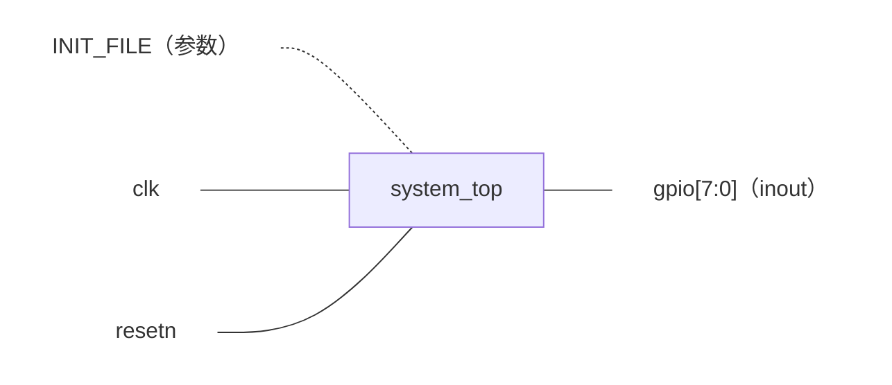
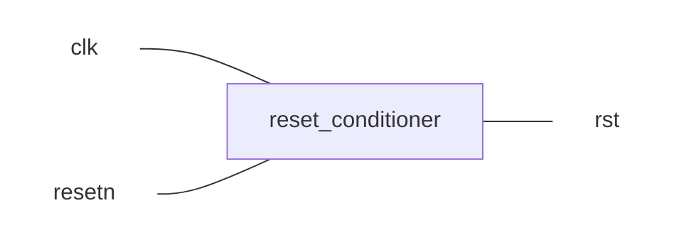
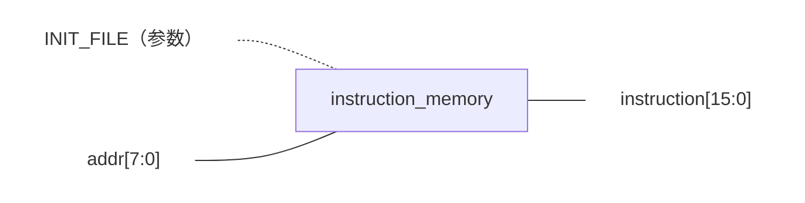
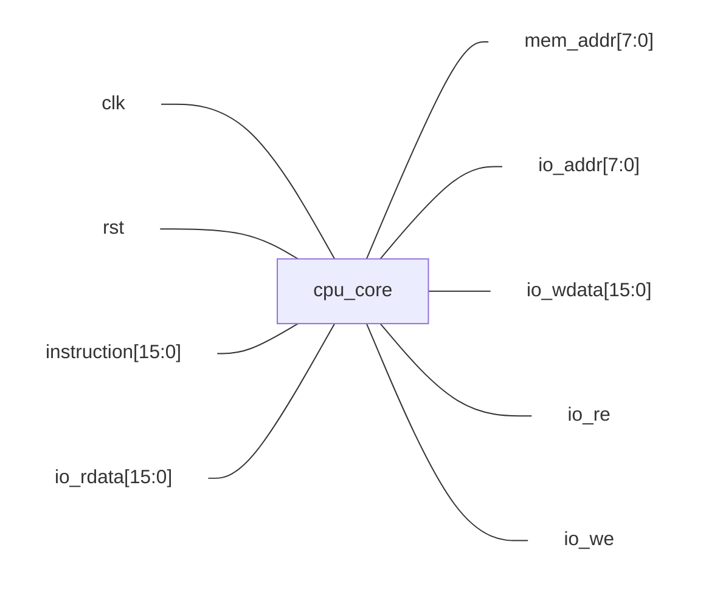
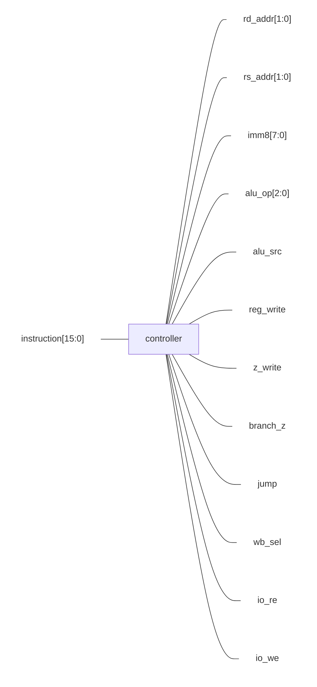
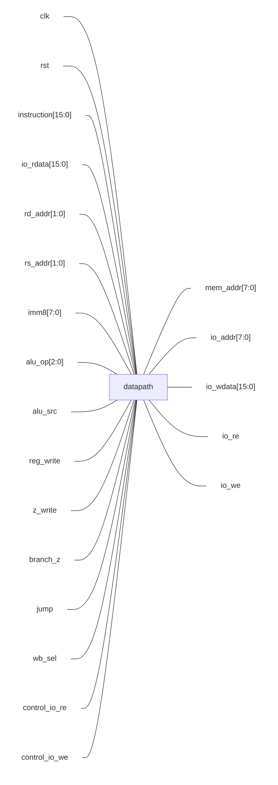
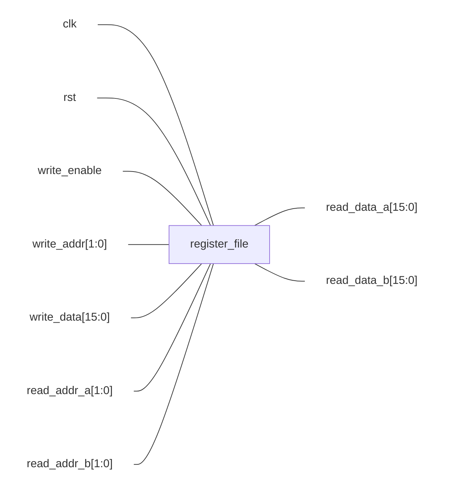
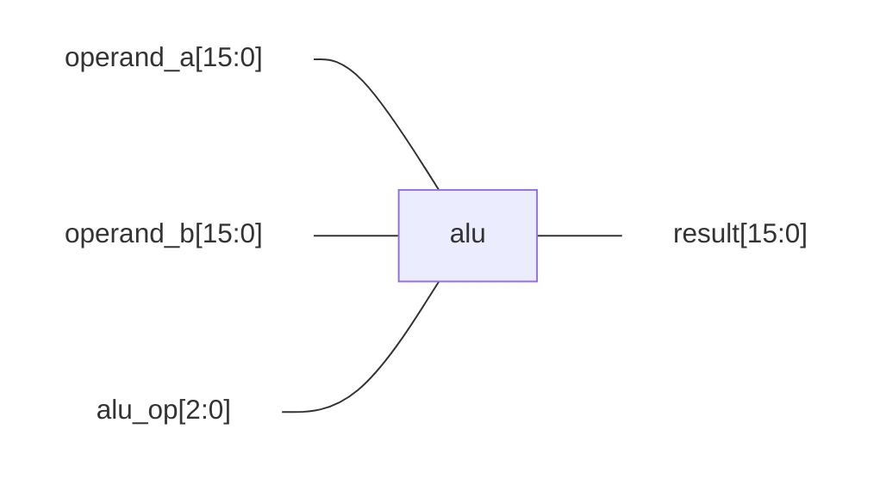
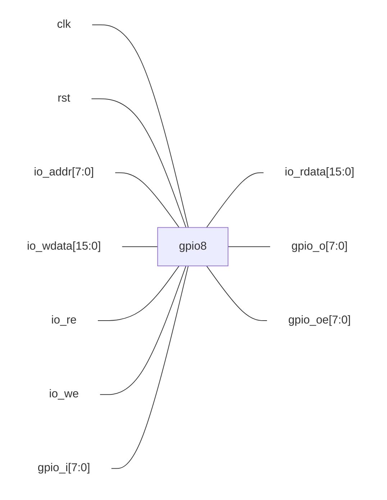

# MiniRISC-16 RTL 模块层级与独立端口框

本文件只表示9个真实 Verilog 模块。每个模块单独画框，框内只写模块名；输入位于左侧，输出位于右侧。端口短线只表示端口属于该模块，不表示模块之间已经连线。

推荐使用的模块级单页版本见 [SYSTEM_TOP_LEVEL.drawio](SYSTEM_TOP_LEVEL.drawio)：沿用顶层版式，只展开到 `register_file` 和 `alu`，与本文件列出的9个真实模块层级一致，并以连续正交线连接全部模块端口。GPIO 三态驱动和 datapath 未展开逻辑均明确标为非 module。备选排版见 [SYSTEM_TOP_MODULE_HIERARCHY.drawio](SYSTEM_TOP_MODULE_HIERARCHY.drawio)。包含 datapath 推断逻辑的细化参考图见 [SYSTEM_TOP_WITH_DATAPATH_INTERNAL.drawio](SYSTEM_TOP_WITH_DATAPATH_INTERNAL.drawio)。较简化的 `cpu_core` 单页版本见 [SYSTEM_TOP_WITH_CPU_INTERNAL.drawio](SYSTEM_TOP_WITH_CPU_INTERNAL.drawio)。两页分层版本见 [SYSTEM_TOP_AND_CPU_CORE_CONNECTED.drawio](SYSTEM_TOP_AND_CPU_CORE_CONNECTED.drawio)：第1页连接 `system_top` 一级全部端口，第2页单独展开并连接 `cpu_core` 内的 `controller` 与 `datapath`。

## 1. 模块层级

```text
system_top
├─ reset_conditioner
├─ instruction_memory
├─ cpu_core
│  ├─ controller
│  └─ datapath
│     ├─ register_file
│     └─ alu
└─ gpio8
```

共9个独立 Verilog 模块：`system_top`、`reset_conditioner`、`instruction_memory`、`cpu_core`、`controller`、`datapath`、`register_file`、`alu`、`gpio8`。

## 2. `system_top`



## 3. `reset_conditioner`



## 4. `instruction_memory`



## 5. `cpu_core`



## 6. `controller`



## 7. `datapath`



## 8. `register_file`



## 9. `alu`



## 10. `gpio8`



## 11. 端口数量核对

| 模块 | 输入 | 输出 | `inout` | 总端口 |
|---|---:|---:|---:|---:|
| `system_top` | 2 | 0 | 1 | 3 |
| `reset_conditioner` | 2 | 1 | 0 | 3 |
| `instruction_memory` | 1 | 1 | 0 | 2 |
| `cpu_core` | 4 | 5 | 0 | 9 |
| `controller` | 1 | 12 | 0 | 13 |
| `datapath` | 16 | 5 | 0 | 21 |
| `register_file` | 7 | 2 | 0 | 9 |
| `alu` | 3 | 1 | 0 | 4 |
| `gpio8` | 7 | 3 | 0 | 10 |
| **合计** | **43** | **30** | **1** | **74** |

`INIT_FILE` 是 elaboration 参数，不属于输入端口，因此不计入74个模块端口。
