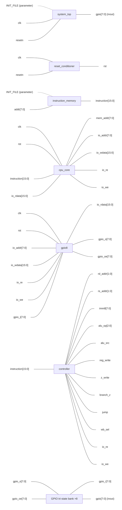
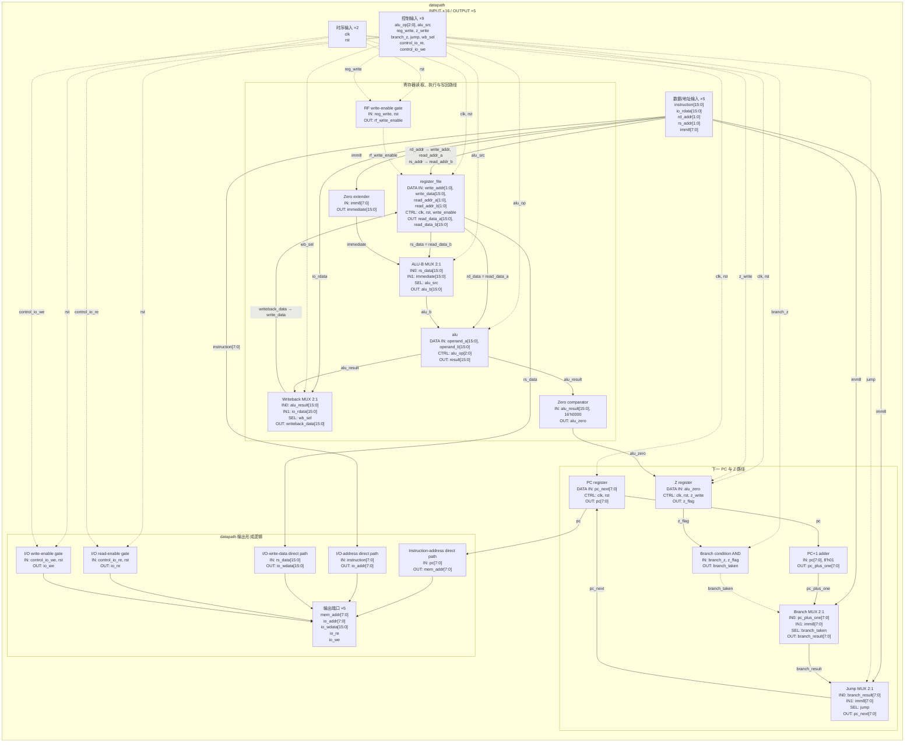
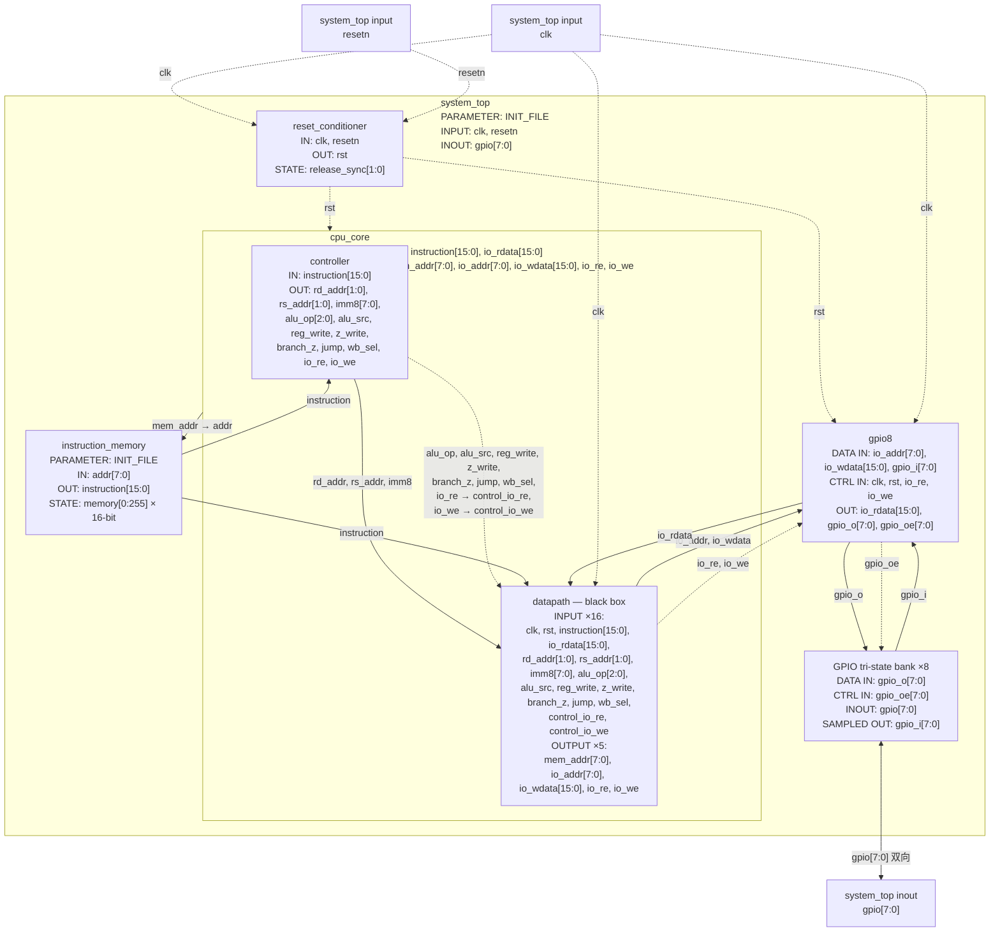

# MiniRISC-16 RTL 结构反推与单周期执行分析

## 1. 分析范围与结论

本文直接依据 `rtl/` 下的 Verilog 源码，自顶向下反推 MiniRISC-16 的模块层级、接口、内部状态和跨模块数据流。分析对象是 9 个可综合 RTL 模块，不包含 `sim/tb/` 下的 testbench。

该设计是一个非流水线单周期 CPU。这里的“单周期”不是省略取指、译码、执行、I/O 和写回，而是这些逻辑阶段在两个相邻时钟上升沿之间连续完成；周期结束时，PC、寄存器、Z 标志或 GPIO 寄存器同时按各自写使能提交。

## 2. RTL 层级结构

### 2.1 Verilog 模块实例层级

```text
system_top
├─ reset_conditioner
├─ instruction_memory
├─ cpu_core
│  ├─ controller
│  └─ datapath
│     ├─ register_file
│     └─ alu
└─ gpio8
```

| 层级 | 模块 | 源文件 | 主要作用 |
|---:|---|---|---|
| 0 | `system_top` | `rtl/top/system_top.v` | 板级顶层，连接复位、指令 ROM、CPU 核和 GPIO，并形成物理三态端口 |
| 1 | `reset_conditioner` | `rtl/peripherals/reset_conditioner.v` | 将外部低有效复位转换为内部高有效复位，实现异步置位、两级同步释放 |
| 1 | `instruction_memory` | `rtl/peripherals/instruction_memory.v` | 256×16 位组合读指令 ROM |
| 1 | `cpu_core` | `rtl/core/cpu_core.v` | CPU 核封装，连接控制器与数据通路 |
| 2 | `controller` | `rtl/core/controller.v` | 解析指令字段和 opcode，产生控制信号 |
| 2 | `datapath` | `rtl/core/datapath.v` | 完成 PC、Z、寄存器、ALU、写回和 I/O 数据通路 |
| 3 | `register_file` | `rtl/core/register_file.v` | 4×16 位通用寄存器组，双端口组合读、单端口同步写 |
| 3 | `alu` | `rtl/core/alu.v` | 16 位组合 ALU，支持直通、加、减、与、或、异或 |
| 1 | `gpio8` | `rtl/peripherals/gpio8.v` | 8 位 GPIO 的输出、输入和方向寄存器及地址译码 |

### 2.2 包含内部寄存器和 MUX 的完整结构层级

下面的树同时表示两类结构：标有“模块”的节点对应独立的 Verilog `module`；标有“内部结构”的节点由寄存器、连续赋值、条件运算符或 `case` 语句综合得到，不对应单独的 `.v` 模块。

```text
system_top                                      [模块]
├─ reset_conditioner                            [模块]
│  ├─ release_sync[1:0]                         [内部寄存器]
│  └─ rst 反相输出逻辑                           [内部组合逻辑]
│
├─ instruction_memory                           [模块]
│  ├─ memory[0:255]，每项 16 位                  [内部 ROM]
│  └─ addr → instruction                        [内部组合读]
│
├─ cpu_core                                     [模块]
│  ├─ controller                                [模块]
│  │  ├─ 指令字段拆分                            [内部组合逻辑]
│  │  │  ├─ opcode = instruction[15:12]
│  │  │  ├─ rd_addr = instruction[11:10]
│  │  │  ├─ rs_addr = instruction[9:8]
│  │  │  └─ imm8 = instruction[7:0]
│  │  └─ opcode 控制译码                         [内部 case 组合逻辑]
│  │
│  └─ datapath                                  [模块]
│     ├─ pc[7:0]                                [内部寄存器]
│     ├─ z_flag                                 [内部寄存器]
│     ├─ register_file                          [模块]
│     │  └─ registers[0:3]，每项 16 位           [内部寄存器]
│     ├─ imm8 零扩展为 16 位                     [内部组合逻辑]
│     ├─ ALU-B MUX                              [内部 2:1 MUX]
│     │  ├─ 0：rs_data = R[Rs]
│     │  └─ 1：immediate = {8'h00, imm8}
│     ├─ alu                                    [模块]
│     │  └─ PASS_B/ADD/SUB/AND/OR/XOR           [内部组合逻辑]
│     ├─ Writeback MUX                          [内部 2:1 MUX]
│     │  ├─ 0：alu_result
│     │  └─ 1：io_rdata
│     ├─ PC+1 加法器                             [内部组合逻辑]
│     ├─ Next-PC MUX                            [内部优先选择 MUX]
│     │  ├─ jump=1：imm8
│     │  ├─ branch_z & z_flag=1：imm8
│     │  └─ 其他：pc_plus_one
│     └─ RF/I/O 复位屏蔽                         [内部与门逻辑]
│
├─ gpio8                                        [模块]
│  ├─ gpio_out[7:0]                             [内部寄存器]
│  ├─ gpio_dir[7:0]                             [内部寄存器]
│  ├─ input_sync_1[7:0]                         [第一级输入同步寄存器]
│  ├─ input_sync_2[7:0]                         [第二级输入同步寄存器]
│  ├─ I/O 写地址译码                             [内部 case 逻辑]
│  └─ GPIO Read MUX                             [内部组合 MUX]
│     ├─ 0x10：GPIO_OUT
│     ├─ 0x11：GPIO_IN
│     ├─ 0x12：GPIO_DIR
│     └─ 其他或 io_re=0：16'h0000
│
└─ g_gpio_tristate × 8                          [内部生成结构]
   └─ gpio_oe[i] ? gpio_o[i] : 1'bz             [逐位三态选择]
```

从 CPU 指令数据通路角度看，三个必须明确画出的核心 MUX 都位于 `datapath` 内部，而不是独立模块：

| 所属层级 | MUX | 选择信号 | 输入 0 | 输入 1/其他 | 输出去向 |
|---|---|---|---|---|---|
| `cpu_core/datapath` | ALU-B MUX | `alu_src` | `rs_data` | `immediate` | `alu.operand_b` |
| `cpu_core/datapath` | Writeback MUX | `wb_sel` | `alu_result` | `io_rdata` | `register_file.write_data` |
| `cpu_core/datapath` | Next-PC MUX | `jump`、`branch_z & z_flag` | `pc_plus_one` | `imm8` | `pc` 的下一状态 |

此外，`gpio8` 的读地址 `case` 会综合成 GPIO Read MUX；`system_top` 的条件赋值会综合成 FPGA I/O 三态控制结构。它们属于外设和板级接口，不属于 CPU 核内的三个主要数据通路 MUX。

## 3. 单周期执行如何在 RTL 中体现

### 3.1 逻辑阶段不等于多个时钟周期

多周期 CPU 会用状态机或阶段寄存器，让取指、译码、执行、访存、写回分别占用不同的时钟周期。本设计仍可按这五个逻辑阶段理解，但阶段之间没有时钟寄存器，也没有控制步骤推进的有限状态机。

```text
时钟上升沿 N
    │ 上一条指令提交；PC、R0～R3、Z 和 GPIO 状态稳定
    ▼
  当前 PC
    │
    ├─ 取指：instruction_memory 组合读
    ├─ 译码：controller 组合产生字段和控制信号
    ├─ 读寄存器：register_file 组合读
    ├─ 执行：操作数选择和 alu 组合运算
    ├─ I/O/写回：gpio8 组合读和写回 MUX
    └─ 下一 PC：PC+1、JZ 目标、JUMP 目标组合选择
    ▼
时钟上升沿 N+1
    │ 同时提交当前指令要求的 PC、Rd、Z 或 GPIO 更新
```

逻辑阶段全部落在一个时钟周期内，因此一个周期的时钟长度必须覆盖最慢的组合路径及寄存器建立时间。设计以较长的组合关键路径换取了每条普通指令一个周期完成，即复位解除后理论 CPI 为 1。

### 3.2 各阶段的代码依据

| 逻辑阶段 | 主要 RTL | 单周期依据 |
|---|---|---|
| IF：取指 | `pc -> mem_addr -> instruction_memory -> instruction` | ROM 使用连续赋值 `instruction = memory[addr]`，地址改变后组合输出指令 |
| ID：译码 | `controller` | `opcode` 和指令字段由连续赋值/`always @*` 产生，没有时钟和状态机 |
| RF：读寄存器 | `register_file` | `read_data_a/b` 直接索引寄存器数组，是组合读 |
| EX：执行 | `alu_src` MUX 和 `alu` | 操作数选择及六种 ALU 运算均为组合逻辑 |
| I/O：外设访问 | `io_addr/io_re/io_we` 与 `gpio8` | GPIO 读数据组合返回；写使能在周期内产生并在周期末写入 GPIO 寄存器 |
| WB：写回 | `wb_sel` MUX 与 `register_file` | ALU 或 I/O 数据在周期内到达 `write_data`，上升沿写入 Rd |
| Next PC | `pc_plus_one/pc_next` | PC+1、JZ 和 JUMP 选择均为组合逻辑，上升沿更新 PC |

### 3.3 周期边界上的状态提交

| 状态 | 所属模块 | 更新条件 | 复位值 |
|---|---|---|---:|
| `pc` | `datapath` | 每个非复位上升沿写入 `pc_next` | `0x00` |
| `z_flag` | `datapath` | `z_write=1` 时，在上升沿写入 `alu_result==0` | `0` |
| `registers[0:3]` | `register_file` | `write_enable=1` 时，在上升沿写入一个 Rd | 全部 `0x0000` |
| `gpio_out` | `gpio8` | `io_we=1` 且地址为 `0x10` | `0x00` |
| `gpio_dir` | `gpio8` | `io_we=1` 且地址为 `0x12` | `0x00` |
| `input_sync_1/2` | `gpio8` | 每个非复位上升沿采样推进 | `0x00` |
| `release_sync` | `reset_conditioner` | 外部复位异步清零，随后每个上升沿移入 1 | `0b00` |

这些状态分布在不同模块的 `always @(posedge clk...)` 中，但它们观察的是同一个时钟沿。Verilog 非阻塞赋值保证各模块依据上升沿之前的稳定值同时提交新状态。

### 3.4 五类指令的单周期路径

#### MOVI：立即数写寄存器

```text
PC → ROM → MOVI 译码 → imm8 零扩展 → ALU PASS_B
   → 写回 MUX 选择 ALU → 上升沿写 Rd
PC → PC+1 → 同一上升沿更新 PC
```

译码产生 `alu_src=1`、`alu_op=PASS_B`、`reg_write=1`。立即数、ALU 结果和写回数据均在周期内组合传播。

#### CMP：比较并更新 Z

```text
PC → ROM → CMP 译码 → 读取 R[Rd] 与 R[Rs]
   → ALU SUB → 判断结果是否为 0 → 上升沿更新 Z
```

CMP 置 `z_write=1`、`reg_write=0`，所以只更新 Z，不写通用寄存器。

#### JZ：使用此前保存的 Z 更新 PC

```text
PC → ROM → JZ 译码 ───────────────┐
旧 z_flag ─────────────────────────┼→ 选择 imm8 或 PC+1 → 上升沿更新 PC
instruction[7:0] → imm8 ──────────┘
```

JZ 使用的是前一条 CMP 已在上一个上升沿保存的 `z_flag`。CMP 和随后的 JZ 各占一个周期，但每条指令自身仍在单周期内完成。

#### INP：I/O 组合读并写回

```text
PC → ROM → INP 译码 → io_addr/io_re → gpio8 组合读
   → io_rdata → 写回 MUX → 上升沿写 Rd
```

INP 置 `wb_sel=1`、`io_re=1` 和 `reg_write=1`。读取 GPIO_IN 时得到的是 `input_sync_2` 中已经同步的值。

#### OUP：寄存器数据写 GPIO

```text
PC → ROM → OUP 译码 → io_addr/io_we ──────────┐
R[Rs] 组合读 → io_wdata ──────────────────────┼→ 上升沿写 GPIO_OUT 或 GPIO_DIR
```

OUP 不写 Rd。GPIO 写入与该条指令的 PC 更新发生在同一个上升沿。

### 3.5 两级同步为何不使 CPU 变成多周期

`gpio8` 的 `input_sync_1/2` 用两个时钟沿将外部异步输入引入 CPU 时钟域；`reset_conditioner` 也用两个时钟沿安全释放复位。这些是接口信号调理延迟，不是把一条 CPU 指令拆分为多个执行周期。

INP 指令仍在一个周期内读取当时已经存在的 `input_sync_2` 并写回 Rd。它不会停顿等待新的外部引脚值穿过同步器。类似地，复位释放期间 CPU 处于复位状态，不计入正常指令 CPI。

## 4. 顶层互连信号

| 信号 | 宽度 | 驱动模块 | 接收模块 | 作用 |
|---|---:|---|---|---|
| `rst` | 1 | `reset_conditioner` | `cpu_core`、`gpio8` | 内部同步高有效复位 |
| `mem_addr` | 8 | `cpu_core/datapath` | `instruction_memory` | 当前 PC 对应的指令地址 |
| `instruction` | 16 | `instruction_memory` | `cpu_core` | 当前组合读出的指令 |
| `io_addr` | 8 | `cpu_core/datapath` | `gpio8` | I/O 地址，即指令低 8 位 |
| `io_wdata` | 16 | `cpu_core/datapath` | `gpio8` | OUP 写数据，即 `R[Rs]` |
| `io_rdata` | 16 | `gpio8` | `cpu_core/datapath` | INP 组合读数据 |
| `io_re` | 1 | `cpu_core/datapath` | `gpio8` | I/O 读使能，复位期间强制为 0 |
| `io_we` | 1 | `cpu_core/datapath` | `gpio8` | I/O 写使能，复位期间强制为 0 |
| `gpio_i` | 8 | 顶层物理 `gpio` 采样 | `gpio8` | GPIO 输入数据 |
| `gpio_o` | 8 | `gpio8` | 顶层三态逻辑 | GPIO 输出锁存值 |
| `gpio_oe` | 8 | `gpio8` | 顶层三态逻辑 | 每位输出使能，1=输出，0=高阻输入 |

## 5. 模块逐层分析

### 5.1 `system_top`

- 文件：`rtl/top/system_top.v`
- 层级位置：整个可综合设计的顶层模块
- 下级实例：`reset_conditioner`、`instruction_memory`、`cpu_core`、`gpio8`
- 内部状态：无

#### 参数

| 参数 | 默认值 | 作用 |
|---|---|---|
| `INIT_FILE` | 空字符串 | 传递给 `instruction_memory`，指定 `$readmemh` 使用的程序文件 |

#### 端口

| 方向 | 端口 | 宽度 | 来源/去向 | 作用 |
|---|---|---:|---|---|
| 输入 | `clk` | 1 | 板级时钟 → 全部时序模块 | CPU、GPIO 和复位同步器的公共时钟 |
| 输入 | `resetn` | 1 | 板级复位 → `reset_conditioner` | 外部低有效复位 |
| 双向 | `gpio` | 8 | FPGA 管脚 ↔ 顶层三态逻辑 | 8 个逐位可配置方向的 GPIO 引脚 |

#### 内部行为

顶层负责连接 CPU 的取指和 I/O 接口。每个 GPIO 位使用以下三态关系：

```text
gpio_oe[i] = 1  → gpio[i] = gpio_o[i]
gpio_oe[i] = 0  → gpio[i] = Z，由外部设备驱动并通过 gpio_i[i] 采样
```

`system_top` 没有时序状态，不增加指令周期。它只是把内部组合信号和物理端口连接起来。

### 5.2 `reset_conditioner`

- 文件：`rtl/peripherals/reset_conditioner.v`
- 上级：`system_top`
- 下级：无
- 内部状态：2 位寄存器 `release_sync`

#### 端口

| 方向 | 端口 | 宽度 | 来源/去向 | 作用 |
|---|---|---:|---|---|
| 输入 | `clk` | 1 | `system_top` | 同步释放复位所用时钟 |
| 输入 | `resetn` | 1 | 板级输入 | 低有效外部复位 |
| 输出 | `rst` | 1 | → `cpu_core`、`gpio8` | 高有效内部复位 |

#### 内部行为

`resetn=0` 时，`release_sync` 通过 `negedge resetn` 异步清零，因而 `rst=~release_sync[1]` 立即变为 1。`resetn` 回到 1 后，第一个有效上升沿将同步链变为 `01`，第二个上升沿变为 `11`，随后 `rst` 才变为 0。

CPU 和 GPIO 的状态寄存器使用同步高有效 `rst`，因此在时钟上升沿完成清零；CPU 的 I/O 使能还被 `rst` 组合屏蔽。

### 5.3 `instruction_memory`

- 文件：`rtl/peripherals/instruction_memory.v`
- 上级：`system_top`
- 下级：无
- 内部存储：`memory[0:255]`，每项 16 位

#### 参数

| 参数 | 默认值 | 作用 |
|---|---|---|
| `INIT_FILE` | 空字符串 | 非空时通过 `$readmemh` 初始化指令 ROM |

#### 端口

| 方向 | 端口 | 宽度 | 来源/去向 | 作用 |
|---|---|---:|---|---|
| 输入 | `addr` | 8 | `cpu_core.mem_addr` | 选择 256 个指令字之一 |
| 输出 | `instruction` | 16 | → `cpu_core` | 当前地址对应的组合读指令 |

#### 内部行为

初始化时，全部地址先填入 `16'hF000`，即安全保留操作；若 `INIT_FILE` 非空，再由程序文件覆盖相应地址。读取使用连续赋值 `instruction=memory[addr]`，没有时钟等待，这是单周期取指成立的重要条件。

### 5.4 `cpu_core`

- 文件：`rtl/core/cpu_core.v`
- 上级：`system_top`
- 下级实例：`controller`、`datapath`
- 内部状态：无，状态均位于 `datapath` 及其子模块

#### 端口

| 方向 | 端口 | 宽度 | 来源/去向 | 作用 |
|---|---|---:|---|---|
| 输入 | `clk` | 1 | `system_top` → `datapath` | CPU 状态提交时钟 |
| 输入 | `rst` | 1 | `reset_conditioner` → `datapath` | 同步高有效 CPU 复位 |
| 输入 | `instruction` | 16 | `instruction_memory` | 当前指令字 |
| 输入 | `io_rdata` | 16 | `gpio8` | 外设组合读数据 |
| 输出 | `mem_addr` | 8 | → `instruction_memory` | 当前 PC |
| 输出 | `io_addr` | 8 | → `gpio8` | 指令低 8 位形成的 I/O 地址 |
| 输出 | `io_wdata` | 16 | → `gpio8` | `R[Rs]` 形成的 I/O 写数据 |
| 输出 | `io_re` | 1 | → `gpio8` | 复位屏蔽后的 I/O 读使能 |
| 输出 | `io_we` | 1 | → `gpio8` | 复位屏蔽后的 I/O 写使能 |

#### 内部行为

`controller` 接收指令并产生寄存器地址、立即数和控制信号；`datapath` 接收这些信号完成实际的数据运算和状态更新。二者之间只有组合控制连线，没有阶段寄存器，因此 `cpu_core` 不会将译码和执行拆成多个周期。

### 5.5 `controller`

- 文件：`rtl/core/controller.v`
- 上级：`cpu_core`
- 下级：无
- 内部状态：无，整个模块为组合逻辑

#### 端口

| 方向 | 端口 | 宽度 | 来源/去向 | 作用 |
|---|---|---:|---|---|
| 输入 | `instruction` | 16 | `cpu_core` | 待解析的当前指令 |
| 输出 | `rd_addr` | 2 | → `datapath/register_file` | `instruction[11:10]`，目的寄存器及 A 操作数地址 |
| 输出 | `rs_addr` | 2 | → `datapath/register_file` | `instruction[9:8]`，源寄存器及 B 操作数地址 |
| 输出 | `imm8` | 8 | → `datapath` | `instruction[7:0]`，立即数、跳转目标或端口地址 |
| 输出 | `alu_op` | 3 | → `alu` | ALU 运算选择 |
| 输出 | `alu_src` | 1 | → `datapath` | B 操作数选择：0=`R[Rs]`，1=零扩展立即数 |
| 输出 | `reg_write` | 1 | → `datapath/register_file` | 通用寄存器写使能请求 |
| 输出 | `z_write` | 1 | → `datapath` | Z 标志写使能，仅 CMP 置 1 |
| 输出 | `branch_z` | 1 | → `datapath` | JZ 条件跳转控制 |
| 输出 | `jump` | 1 | → `datapath` | JUMP 无条件跳转控制 |
| 输出 | `wb_sel` | 1 | → `datapath` | 写回来源：0=ALU，1=I/O |
| 输出 | `io_re` | 1 | → `datapath` | INP 的 I/O 读请求 |
| 输出 | `io_we` | 1 | → `datapath` | OUP 的 I/O 写请求 |

#### 内部行为

`opcode=instruction[15:12]`。组合 `always @*` 先为全部控制信号设置无副作用的默认值，再按 opcode 覆盖。`0xD～0xF` 保持默认值，不写寄存器、不写 Z、不跳转、也不访问 I/O。完整逐 opcode 控制表见 [CONTROL_TABLE.md](CONTROL_TABLE.md)。

### 5.6 `datapath`

- 文件：`rtl/core/datapath.v`
- 上级：`cpu_core`
- 下级实例：`register_file`、`alu`
- 内部状态：8 位 `pc`、1 位 `z_flag`；寄存器状态位于子模块 `register_file`

#### 端口

| 方向 | 端口 | 宽度 | 来源/去向 | 作用 |
|---|---|---:|---|---|
| 输入 | `clk` | 1 | `cpu_core` | PC、Z 和寄存器写回时钟 |
| 输入 | `rst` | 1 | `cpu_core` | 同步高有效复位，并组合屏蔽写使能 |
| 输入 | `instruction` | 16 | `cpu_core` | 低 8 位直接形成 `io_addr` |
| 输入 | `io_rdata` | 16 | `gpio8` | INP 写回数据候选 |
| 输入 | `rd_addr` | 2 | `controller` | Rd 读地址和写地址 |
| 输入 | `rs_addr` | 2 | `controller` | Rs 读地址 |
| 输入 | `imm8` | 8 | `controller` | 零扩展立即数或跳转目标 |
| 输入 | `alu_op` | 3 | `controller` | ALU 运算编码 |
| 输入 | `alu_src` | 1 | `controller` | ALU B 操作数选择 |
| 输入 | `reg_write` | 1 | `controller` | 寄存器写请求 |
| 输入 | `z_write` | 1 | `controller` | Z 标志写请求 |
| 输入 | `branch_z` | 1 | `controller` | 条件跳转请求 |
| 输入 | `jump` | 1 | `controller` | 无条件跳转请求 |
| 输入 | `wb_sel` | 1 | `controller` | ALU/I/O 写回选择 |
| 输入 | `control_io_re` | 1 | `controller` | 未经复位屏蔽的 I/O 读请求 |
| 输入 | `control_io_we` | 1 | `controller` | 未经复位屏蔽的 I/O 写请求 |
| 输出 | `mem_addr` | 8 | → `instruction_memory` | 当前 `pc` |
| 输出 | `io_addr` | 8 | → `gpio8` | `instruction[7:0]` |
| 输出 | `io_wdata` | 16 | → `gpio8` | `R[Rs]` |
| 输出 | `io_re` | 1 | → `gpio8` | `control_io_re & ~rst` |
| 输出 | `io_we` | 1 | → `gpio8` | `control_io_we & ~rst` |

#### 内部结构层级

`datapath.v` 只显式例化了 `register_file` 和 `alu` 两个 Verilog 子模块；其余寄存器、MUX、加法器、比较器及门控逻辑由连续赋值和时序块推断得到。按 RTL 画结构图时应完整表示为：

```text
datapath
├─ PC 寄存器
├─ PC+1 加法器
├─ Branch 条件与门
├─ Branch MUX
├─ Jump MUX
├─ Z 寄存器
├─ register_file
├─ 立即数零扩展器
├─ ALU-B MUX
├─ alu
├─ Writeback MUX
├─ 零比较器
├─ RF 写使能门
├─ I/O 读使能门
├─ I/O 写使能门
├─ 指令地址直连
├─ I/O 地址直连
└─ I/O 写数据直连
```

其中 Branch MUX 与 Jump MUX 是对嵌套条件表达式的结构化展开。综合器可能对它们进行逻辑优化，但按 RTL 画图时保留两个 MUX 最能体现 `branch_z`、`z_flag`、`jump` 的控制关系和 JUMP 的优先级。

#### 各内部单元的完整输入、控制和输出

| 内部单元 | 数据输入 | 控制/时序输入 | 输出 | 对应 RTL 与说明 |
|---|---|---|---|---|
| PC 寄存器 | `pc_next[7:0]` | `clk`、同步高有效 `rst` | `pc[7:0]` | 复位写 `8'h00`；每个非复位上升沿写入下一 PC，无独立写使能 |
| PC+1 加法器 | `pc[7:0]`、常数 `8'h01` | 无 | `pc_plus_one[7:0]` | `pc + 8'h01`，8 位自然回绕 |
| Branch 条件与门 | `branch_z`、`z_flag` | 无 | `branch_taken` | 逻辑值为 `branch_z & z_flag` |
| Branch MUX（2:1） | 输入0=`pc_plus_one[7:0]`；输入1=`imm8[7:0]` | 选择端=`branch_taken` | `branch_result[7:0]` | 0 顺序执行，1 选择 JZ 目标地址 |
| Jump MUX（2:1） | 输入0=`branch_result[7:0]`；输入1=`imm8[7:0]` | 选择端=`jump` | `pc_next[7:0]` | 0 保留分支选择结果，1 选择 JUMP 目标；位于外层所以 JUMP 优先 |
| Z 寄存器 | `alu_zero` | `clk`、同步高有效 `rst`、写使能=`z_write` | `z_flag` | 复位清 0；仅 `z_write=1` 的上升沿更新 |
| `register_file` | `write_data=writeback_data[15:0]`、`write_addr=rd_addr[1:0]`、`read_addr_a=rd_addr[1:0]`、`read_addr_b=rs_addr[1:0]` | `clk`、同步高有效 `rst`、`write_enable=rf_write_enable` | `rd_data[15:0]`、`rs_data[15:0]` | 4×16 位寄存器；双端口组合读、单端口同步写 |
| 立即数零扩展器 | `imm8[7:0]` | 无 | `immediate[15:0]` | `immediate={8'h00,imm8}` |
| ALU-B MUX（2:1） | 输入0=`rs_data[15:0]`；输入1=`immediate[15:0]` | 选择端=`alu_src` | `alu_b[15:0]` | 0 选择寄存器 Rs，1 选择零扩展立即数 |
| `alu` | `operand_a=rd_data[15:0]`、`operand_b=alu_b[15:0]` | `alu_op[2:0]` | `alu_result[15:0]` | 组合完成 PASS_B、ADD、SUB、AND、OR、XOR |
| Writeback MUX（2:1） | 输入0=`alu_result[15:0]`；输入1=`io_rdata[15:0]` | 选择端=`wb_sel` | `writeback_data[15:0]` | 0 写回 ALU 结果，1 写回 GPIO/I/O 读数据 |
| 零比较器 | `alu_result[15:0]`、常数 `16'h0000` | 无 | `alu_zero` | `alu_result==16'h0000`；结果送 Z 寄存器 D 端 |
| RF 写使能门 | `reg_write`、`rst` | 无 | `rf_write_enable` | `reg_write & ~rst`，复位时禁止写通用寄存器 |
| I/O 读使能门 | `control_io_re`、`rst` | 无 | `io_re` | `control_io_re & ~rst`，复位时禁止 I/O 读请求 |
| I/O 写使能门 | `control_io_we`、`rst` | 无 | `io_we` | `control_io_we & ~rst`，复位时禁止 I/O 写请求 |
| 指令地址直连 | `pc[7:0]` | 无 | `mem_addr[7:0]` | 当前 PC 直接送指令 ROM 地址端 |
| I/O 地址直连 | `instruction[7:0]` | 无 | `io_addr[7:0]` | 指令低 8 位直接作为端口地址 |
| I/O 写数据直连 | `rs_data[15:0]` | 无 | `io_wdata[15:0]` | OUP 将 `R[Rs]` 直接送 GPIO 写数据端 |

注意：表中的 `branch_taken`、`branch_result` 和 `alu_zero` 是为了画图而给组合逻辑结果命名；原始 Verilog 将它们直接写在表达式或时序块中，并没有声明同名 `wire`。它们表示真实可推断的硬件功能，不表示新增 RTL 端口。

#### 四个 2:1 MUX 的端口核对

| MUX | 输入 0 | 输入 1 | 选择端 | 输出 |
|---|---|---|---|---|
| ALU-B MUX | `rs_data[15:0]` | `immediate[15:0]` | `alu_src` | `alu_b[15:0]` |
| Writeback MUX | `alu_result[15:0]` | `io_rdata[15:0]` | `wb_sel` | `writeback_data[15:0]` |
| Branch MUX | `pc_plus_one[7:0]` | `imm8[7:0]` | `branch_z & z_flag` | `branch_result[7:0]` |
| Jump MUX | `branch_result[7:0]` | `imm8[7:0]` | `jump` | `pc_next[7:0]` |

因此，每个 2:1 MUX 都完整具有两个数据输入、一个 1 位选择输入和一个数据输出；前两个 MUX 为 16 位，后两个 MUX 为 8 位。

#### 完整组合数据流

```text
pc[7:0] ───────────────→ mem_addr[7:0] ─→ instruction_memory
   │
   └→ PC+1 ─→ Branch MUX.in0 ─→ branch_result ─→ Jump MUX.in0
imm8 ──────→ Branch MUX.in1                  imm8 ─→ Jump MUX.in1
branch_z ─┐                                      jump ─→ Jump MUX.sel
z_flag ───┴→ AND ─→ Branch MUX.sel                       │
                                                         └→ pc_next ─→ PC.D

rd_addr ─→ register_file.read_addr_a ─→ rd_data ─────────────→ ALU.A
rs_addr ─→ register_file.read_addr_b ─→ rs_data ─┬→ ALU-B MUX.in0
                                                  └→ io_wdata
imm8 ─→ zero extend ─→ immediate ─────────────────→ ALU-B MUX.in1
alu_src ──────────────────────────────────────────→ ALU-B MUX.sel
ALU-B MUX.out ─→ alu_b ─→ ALU.B
alu_op ─────────────────→ ALU.control
ALU.result ─→ alu_result ─┬→ Writeback MUX.in0
                          └→ zero comparator ─→ Z.D
io_rdata ───────────────────→ Writeback MUX.in1
wb_sel ─────────────────────→ Writeback MUX.sel
Writeback MUX.out ─→ writeback_data ─→ register_file.write_data
reg_write & ~rst ────────────────────→ register_file.write_enable

instruction[7:0] ─→ io_addr
control_io_re & ~rst ─→ io_re
control_io_we & ~rst ─→ io_we
```

#### 对应 Verilog 组合表达式

```text
immediate       = {8'h00, imm8}
alu_b           = alu_src ? immediate : rs_data
writeback_data  = wb_sel ? io_rdata : alu_result
rf_write_enable = reg_write & ~rst
pc_plus_one     = pc + 1
branch_result   = (branch_z & z_flag) ? imm8 : pc_plus_one
pc_next         = jump ? imm8 : branch_result
```

最后两式是对源代码嵌套表达式的等价拆分，便于画成 Branch MUX 和 Jump MUX。

#### 时序行为与单周期边界

上升沿且 `rst=1` 时，`pc` 和 `z_flag` 清零；`register_file` 同时清零 R0～R3。否则，`pc` 每周期写入 `pc_next`，`z_flag` 仅在 `z_write=1` 时写入零比较结果，通用寄存器仅在 `rf_write_enable=1` 时写入 `writeback_data`。

从一个上升沿到下一个上升沿，取指、译码、寄存器组合读、MUX 选择、ALU 运算、写回选择和下一 PC 选择全部通过组合逻辑传播；到下一个上升沿才同时提交 PC、可选的 Rd 和可选的 Z。因此这些内部单元都属于同一个单周期数据通路，不是多个时钟阶段。

### 5.7 `register_file`

- 文件：`rtl/core/register_file.v`
- 上级：`datapath`
- 下级：无
- 内部状态：4 个 16 位寄存器 `registers[0:3]`

#### 端口

| 方向 | 端口 | 宽度 | 来源/去向 | 作用 |
|---|---|---:|---|---|
| 输入 | `clk` | 1 | `datapath` | 同步写入时钟 |
| 输入 | `rst` | 1 | `datapath` | 同步高有效清零 |
| 输入 | `write_enable` | 1 | `datapath.rf_write_enable` | 通用寄存器写使能 |
| 输入 | `write_addr` | 2 | `rd_addr` | 写入 R0～R3 的选择地址 |
| 输入 | `write_data` | 16 | `writeback_data` | ALU 或 I/O 写回数据 |
| 输入 | `read_addr_a` | 2 | `rd_addr` | A 读端口地址 |
| 输入 | `read_addr_b` | 2 | `rs_addr` | B 读端口地址 |
| 输出 | `read_data_a` | 16 | → `alu.operand_a` | `R[Rd]` 组合读数据 |
| 输出 | `read_data_b` | 16 | → ALU B MUX、`io_wdata` | `R[Rs]` 组合读数据 |

#### 内部行为

两个读端口直接索引寄存器数组，不需要时钟。写端口在上升沿工作；复位优先于写入并清零全部四个寄存器。R0 没有硬连零限制，与 R1～R3 一样可写。

### 5.8 `alu`

- 文件：`rtl/core/alu.v`
- 上级：`datapath`
- 下级：无
- 内部状态：无，整个模块为组合逻辑

#### 端口

| 方向 | 端口 | 宽度 | 来源/去向 | 作用 |
|---|---|---:|---|---|
| 输入 | `operand_a` | 16 | `register_file.read_data_a` | A 操作数，即 `R[Rd]` |
| 输入 | `operand_b` | 16 | `datapath.alu_b` | B 操作数，即 `R[Rs]` 或零扩展立即数 |
| 输入 | `alu_op` | 3 | `controller` | 运算选择编码 |
| 输出 | `result` | 16 | → 写回 MUX、Z 比较 | 16 位组合运算结果 |

#### ALU 运算编码

| `alu_op` | 名称 | 结果 |
|---:|---|---|
| `000` | PASS_B | `operand_b` |
| `001` | ADD | `operand_a + operand_b`，结果保留低 16 位 |
| `010` | SUB | `operand_a - operand_b`，结果保留低 16 位 |
| `011` | AND | `operand_a & operand_b` |
| `100` | OR | `operand_a \| operand_b` |
| `101` | XOR | `operand_a ^ operand_b` |
| `110/111` | 默认安全值 | `16'h0000` |

ALU 不保存结果。输入或控制信号改变后，`result` 通过组合逻辑改变，并在当前周期内送往寄存器写回或 CMP 的零判断。

### 5.9 `gpio8`

- 文件：`rtl/peripherals/gpio8.v`
- 上级：`system_top`
- 下级：无
- 内部状态：`gpio_out`、`gpio_dir`、`input_sync_1`、`input_sync_2`，均为 8 位

#### 端口

| 方向 | 端口 | 宽度 | 来源/去向 | 作用 |
|---|---|---:|---|---|
| 输入 | `clk` | 1 | `system_top` | GPIO 写入及输入同步时钟 |
| 输入 | `rst` | 1 | `reset_conditioner` | 同步高有效复位 |
| 输入 | `io_addr` | 8 | `cpu_core` | GPIO 寄存器地址 |
| 输入 | `io_wdata` | 16 | `cpu_core` | OUP 写数据，实际使用低 8 位 |
| 输入 | `io_re` | 1 | `cpu_core` | 组合读使能 |
| 输入 | `io_we` | 1 | `cpu_core` | 同步写使能 |
| 输出 | `io_rdata` | 16 | → `cpu_core` | 零扩展的 GPIO 组合读数据 |
| 输入 | `gpio_i` | 8 | 顶层物理 `gpio` | 未同步的外部输入 |
| 输出 | `gpio_o` | 8 | → 顶层三态逻辑 | `gpio_out` 锁存值 |
| 输出 | `gpio_oe` | 8 | → 顶层三态逻辑 | `gpio_dir` 逐位输出使能 |

#### 地址映射

| 地址 | 寄存器 | 访问 | 读数据 | 写入行为 |
|---:|---|---|---|---|
| `0x10` | GPIO_OUT | 读/写 | `{8'h00, gpio_out}` | `gpio_out <= io_wdata[7:0]` |
| `0x11` | GPIO_IN | 只读 | `{8'h00, input_sync_2}` | 无副作用 |
| `0x12` | GPIO_DIR | 读/写 | `{8'h00, gpio_dir}` | `gpio_dir <= io_wdata[7:0]` |
| 其他 | 未映射 | 无 | `16'h0000` | 无副作用 |

#### 内部行为

`io_rdata` 是组合输出：只有 `io_re=1` 时才按地址返回数据，否则返回 0。`gpio_out` 和 `gpio_dir` 在 `io_we=1` 的上升沿更新。复位时所有 GPIO 状态清零，`gpio_dir=0` 使物理引脚默认处于高阻输入状态。

外部 `gpio_i` 每周期依次进入 `input_sync_1` 和 `input_sync_2`，降低亚稳态传播风险。该同步器不提供机械按键消抖，也不保证多位总线的原子采样。

## 6. 跨模块数据与控制路径

### 6.1 取指路径

```text
datapath.pc
  → cpu_core.mem_addr
  → instruction_memory.addr
  → instruction_memory.instruction
  → cpu_core
  → controller + datapath
```

### 6.2 ALU 写回路径

```text
instruction → controller → rd_addr/rs_addr/alu_src/alu_op
  → register_file 组合读
  → ALU 操作数 MUX
  → alu.result
  → 写回 MUX
  → register_file.write_data
  → 周期末写 Rd
```

### 6.3 INP 路径

```text
instruction[7:0] → io_addr ─────────────┐
controller.io_re → datapath 复位屏蔽 ───┼→ gpio8 组合读
                                       └→ io_rdata → 写回 MUX → 周期末写 Rd
```

### 6.4 OUP 路径

```text
instruction[7:0] → io_addr ─────────────┐
R[Rs] → io_wdata ───────────────────────┼→ gpio8 地址译码 → 周期末更新 OUT/DIR
controller.io_we → datapath 复位屏蔽 ───┘
```

### 6.5 分支和跳转路径

```text
顺序执行：pc_next = pc + 1
JZ 成功： pc_next = imm8，当 branch_z & z_flag = 1
JUMP：    pc_next = imm8，当 jump = 1
```

JUMP 的优先级高于 JZ；controller 的 opcode 表不会同时置位二者，因此该优先级主要用于定义完整的组合逻辑行为。

### 6.6 复位路径

```text
板级 resetn
  → reset_conditioner（异步拉低、两级同步释放）
  → rst
  ├─ datapath：清 PC/Z，屏蔽 RF 和 I/O 写使能
  ├─ register_file：清 R0～R3
  └─ gpio8：清 OUT/DIR/输入同步器
```

### 6.7 GPIO 三态路径

```text
gpio8.gpio_out → gpio_o ──────────────┐
gpio8.gpio_dir → gpio_oe ─────────────┼→ system_top 每位三态驱动 → gpio[7:0]
gpio[7:0] → gpio_i → gpio8 输入同步器 ┘
```

## 7. 单周期判定总结

本设计满足单周期实现的主要结构特征：

1. 指令存储器为组合读，没有取指等待状态。
2. controller、寄存器读取、ALU、I/O 读取、写回选择和下一 PC 选择均为组合逻辑。
3. 逻辑阶段之间没有流水寄存器或多周期阶段寄存器。
4. 没有 IF/ID/EX/MEM/WB 状态机、cycle counter、busy/ready 握手或指令停顿控制。
5. 每个非复位上升沿完成上一周期所选指令的状态提交，并立即开始下一条指令的组合传播。

因此，这些模块可以用“取指—译码—执行—I/O—写回”的逻辑步骤讲解，但不能把它们画成各占一个时钟的时间步骤。正确的时间表达是：所有步骤位于同一个时钟周期内部，周期末统一提交状态。

## 8. 结构图绘制规范

本节把前面的代码分析转换成可以直接用于 Draw.io、Visio 或手绘结构图的绘图规格。最终结构图应包含两个部分：上半部分是端口完整的分层硬件结构，下半部分是单条指令在两个相邻时钟沿之间的执行时间线。

### 8.1 绘图层次和表达规则

1. 最外层画 `system_top` 大边框，只在边框上放置板级端口 `clk`、`resetn` 和 `gpio[7:0]`。
2. `system_top` 内放置四个一级模块：`reset_conditioner`、`instruction_memory`、`cpu_core` 和 `gpio8`。
3. `cpu_core` 内放置 `controller` 和 `datapath`；`datapath` 内放置 `register_file`、`alu`、PC、Z 和三个核心 MUX。
4. 独立 Verilog 模块使用矩形框；模块内部寄存器使用窄矩形；MUX 使用梯形；组合加法器和零比较器使用运算框；顶层 GPIO 使用三态缓冲符号。
5. 数据线使用实线，控制线使用虚线，时钟和复位使用点划线。每根总线标注位宽，例如 `[15:0]` 或 `[7:0]`。
6. 模块边界上的端口名必须与 Verilog 完全一致。内部结构可以使用 `alu_b`、`writeback_data`、`pc_next` 等 RTL 内部信号名。
7. 指令执行示例使用高亮颜色覆盖在正常连线上，不另外画一套脱离真实连接的流程图。

### 8.2 九个模块的完整端口标签

以下签名应原样用于结构图中的模块方框。`I` 表示输入，`O` 表示输出，`IO` 表示双向端口。

```text
system_top #(INIT_FILE)
  I : clk[0:0], resetn[0:0]
  IO: gpio[7:0]

reset_conditioner
  I : clk[0:0], resetn[0:0]
  O : rst[0:0]

instruction_memory #(INIT_FILE)
  I : addr[7:0]
  O : instruction[15:0]

cpu_core
  I : clk[0:0], rst[0:0], instruction[15:0], io_rdata[15:0]
  O : mem_addr[7:0], io_addr[7:0], io_wdata[15:0], io_re[0:0], io_we[0:0]

controller
  I : instruction[15:0]
  O : rd_addr[1:0], rs_addr[1:0], imm8[7:0], alu_op[2:0],
      alu_src[0:0], reg_write[0:0], z_write[0:0], branch_z[0:0],
      jump[0:0], wb_sel[0:0], io_re[0:0], io_we[0:0]

datapath
  I : clk[0:0], rst[0:0], instruction[15:0], io_rdata[15:0],
      rd_addr[1:0], rs_addr[1:0], imm8[7:0], alu_op[2:0],
      alu_src[0:0], reg_write[0:0], z_write[0:0], branch_z[0:0],
      jump[0:0], wb_sel[0:0], control_io_re[0:0], control_io_we[0:0]
  O : mem_addr[7:0], io_addr[7:0], io_wdata[15:0], io_re[0:0], io_we[0:0]

register_file
  I : clk[0:0], rst[0:0], write_enable[0:0], write_addr[1:0],
      write_data[15:0], read_addr_a[1:0], read_addr_b[1:0]
  O : read_data_a[15:0], read_data_b[15:0]

alu
  I : operand_a[15:0], operand_b[15:0], alu_op[2:0]
  O : result[15:0]

gpio8
  I : clk[0:0], rst[0:0], io_addr[7:0], io_wdata[15:0],
      io_re[0:0], io_we[0:0], gpio_i[7:0]
  O : io_rdata[15:0], gpio_o[7:0], gpio_oe[7:0]
```

`[0:0]` 仅用于绘图时明确表示 1 位信号；Verilog 源码中的标量端口不写该范围。

### 8.3 第一层：`system_top` 端口连接

| 起点 | 终点 | 位宽 | 类型 | 绘图说明 |
|---|---|---:|---|---|
| 外部 `clk` | `reset_conditioner.clk` | 1 | 时钟 | 从顶层时钟干线分支 |
| 外部 `clk` | `cpu_core.clk` | 1 | 时钟 | 继续进入 CPU 核 |
| 外部 `clk` | `gpio8.clk` | 1 | 时钟 | 继续进入 GPIO 时序逻辑 |
| 外部 `resetn` | `reset_conditioner.resetn` | 1 | 控制 | 标注“低有效” |
| `reset_conditioner.rst` | `cpu_core.rst` | 1 | 控制 | 内部高有效复位 |
| `reset_conditioner.rst` | `gpio8.rst` | 1 | 控制 | 内部高有效复位 |
| `cpu_core.mem_addr` | `instruction_memory.addr` | 8 | 数据/地址 | 标注 `PC` |
| `instruction_memory.instruction` | `cpu_core.instruction` | 16 | 数据 | 当前指令字 |
| `cpu_core.io_addr` | `gpio8.io_addr` | 8 | 数据/地址 | GPIO 寄存器地址 |
| `cpu_core.io_wdata` | `gpio8.io_wdata` | 16 | 数据 | OUP 写数据 |
| `cpu_core.io_re` | `gpio8.io_re` | 1 | 控制 | INP 读使能 |
| `cpu_core.io_we` | `gpio8.io_we` | 1 | 控制 | OUP 写使能 |
| `gpio8.io_rdata` | `cpu_core.io_rdata` | 16 | 数据 | INP 读返回值 |
| `gpio8.gpio_o` | 顶层三态缓冲数据端 | 8 | 数据 | 逐位输出值 |
| `gpio8.gpio_oe` | 顶层三态缓冲使能端 | 8 | 控制 | 逐位方向/输出使能 |
| 外部 `gpio` | `gpio8.gpio_i` | 8 | 数据 | 顶层先连接为内部 `gpio_i` |
| 顶层三态缓冲输出 | 外部 `gpio` | 8 | 数据 | `gpio_oe ? gpio_o : Z` |

### 8.4 第二层：`cpu_core` 内部连接

| 起点 | 终点 | 位宽 | 类型 |
|---|---|---:|---|
| `cpu_core.instruction` | `controller.instruction` | 16 | 数据 |
| `cpu_core.instruction` | `datapath.instruction` | 16 | 数据 |
| `cpu_core.clk` | `datapath.clk` | 1 | 时钟 |
| `cpu_core.rst` | `datapath.rst` | 1 | 控制 |
| `cpu_core.io_rdata` | `datapath.io_rdata` | 16 | 数据 |
| `controller.rd_addr` | `datapath.rd_addr` | 2 | 数据/地址 |
| `controller.rs_addr` | `datapath.rs_addr` | 2 | 数据/地址 |
| `controller.imm8` | `datapath.imm8` | 8 | 数据 |
| `controller.alu_op` | `datapath.alu_op` | 3 | 控制 |
| `controller.alu_src` | `datapath.alu_src` | 1 | 控制 |
| `controller.reg_write` | `datapath.reg_write` | 1 | 控制 |
| `controller.z_write` | `datapath.z_write` | 1 | 控制 |
| `controller.branch_z` | `datapath.branch_z` | 1 | 控制 |
| `controller.jump` | `datapath.jump` | 1 | 控制 |
| `controller.wb_sel` | `datapath.wb_sel` | 1 | 控制 |
| `controller.io_re` | `datapath.control_io_re` | 1 | 控制 |
| `controller.io_we` | `datapath.control_io_we` | 1 | 控制 |
| `datapath.mem_addr` | `cpu_core.mem_addr` | 8 | 数据/地址 |
| `datapath.io_addr` | `cpu_core.io_addr` | 8 | 数据/地址 |
| `datapath.io_wdata` | `cpu_core.io_wdata` | 16 | 数据 |
| `datapath.io_re` | `cpu_core.io_re` | 1 | 控制 |
| `datapath.io_we` | `cpu_core.io_we` | 1 | 控制 |

### 8.5 第三层：`datapath` 内部连接和 MUX

| 起点 | 终点 | 位宽 | 选择/作用 |
|---|---|---:|---|
| `datapath.clk` | `register_file.clk`、PC 和 Z 寄存器 | 1 | 公共上升沿 |
| `datapath.rst` | `register_file.rst`、PC 和 Z 复位端 | 1 | 同步高有效复位 |
| `rd_addr` | `register_file.write_addr` | 2 | Rd 写地址 |
| `rd_addr` | `register_file.read_addr_a` | 2 | Rd 同时作为 A 读地址 |
| `rs_addr` | `register_file.read_addr_b` | 2 | Rs 作为 B 读地址 |
| `reg_write & ~rst` | `register_file.write_enable` | 1 | 复位屏蔽后的写使能 |
| Writeback MUX 输出 | `register_file.write_data` | 16 | `writeback_data` |
| `register_file.read_data_a` | `alu.operand_a` | 16 | `rd_data=R[Rd]` |
| `register_file.read_data_b` | ALU-B MUX 输入 0 | 16 | `rs_data=R[Rs]` |
| `{8'h00,imm8}` | ALU-B MUX 输入 1 | 16 | 零扩展立即数 |
| `alu_src` | ALU-B MUX 选择端 | 1 | 0=Rs，1=立即数 |
| ALU-B MUX 输出 | `alu.operand_b` | 16 | `alu_b` |
| `alu_op` | `alu.alu_op` | 3 | ALU 控制 |
| `alu.result` | Writeback MUX 输入 0 | 16 | `alu_result` |
| `io_rdata` | Writeback MUX 输入 1 | 16 | 外设读数据 |
| `wb_sel` | Writeback MUX 选择端 | 1 | 0=ALU，1=I/O |
| `alu.result==0` | Z 寄存器 D 端 | 1 | CMP 的零判断结果 |
| `z_write` | Z 寄存器写使能 | 1 | 仅 CMP 有效 |
| `pc` | `mem_addr` | 8 | 当前取指地址 |
| `pc` | PC+1 加法器 | 8 | 顺序地址输入 |
| `pc_plus_one` | Next-PC MUX 默认输入 | 8 | 顺序执行 |
| `imm8` | Next-PC MUX 跳转输入 | 8 | JZ/JUMP 绝对目标 |
| `jump` | Next-PC MUX 最高优先选择 | 1 | JUMP 选择 `imm8` |
| `branch_z & z_flag` | Next-PC MUX 条件选择 | 1 | JZ 成功选择 `imm8` |
| Next-PC MUX 输出 | PC 寄存器 D 端 | 8 | `pc_next` |
| `instruction[7:0]` | `io_addr` | 8 | I/O 地址 |
| `register_file.read_data_b` | `io_wdata` | 16 | OUP 数据 |
| `control_io_re & ~rst` | `io_re` | 1 | 复位屏蔽后的读使能 |
| `control_io_we & ~rst` | `io_we` | 1 | 复位屏蔽后的写使能 |

### 8.6 第四层：GPIO 和复位内部结构

#### `gpio8`

| 起点 | 终点 | 位宽 | 作用 |
|---|---|---:|---|
| `gpio_i` | `input_sync_1` D 端 | 8 | 第一级异步输入采样 |
| `input_sync_1` Q 端 | `input_sync_2` D 端 | 8 | 第二级同步 |
| `io_wdata[7:0]` | `gpio_out` D 端 | 8 | `io_we & io_addr==0x10` 时写入 |
| `io_wdata[7:0]` | `gpio_dir` D 端 | 8 | `io_we & io_addr==0x12` 时写入 |
| `gpio_out` | GPIO Read MUX 的 `0x10` 输入 | 8→16 | 高 8 位补零 |
| `input_sync_2` | GPIO Read MUX 的 `0x11` 输入 | 8→16 | 高 8 位补零 |
| `gpio_dir` | GPIO Read MUX 的 `0x12` 输入 | 8→16 | 高 8 位补零 |
| `io_addr/io_re` | GPIO Read MUX 选择端 | 9 | 未读或未映射时输出 0 |
| GPIO Read MUX | `io_rdata` | 16 | 组合读返回值 |
| `gpio_out` | `gpio_o` | 8 | 连续输出 |
| `gpio_dir` | `gpio_oe` | 8 | 连续输出 |

#### `reset_conditioner`

```text
resetn=0 ──异步清零──→ release_sync[1:0]=00 ──→ rst=1
resetn=1 ──posedge 1─→ release_sync=01
         ──posedge 2─→ release_sync=11 ────────→ rst=0
```

### 8.7 单周期路径高亮示例：`ADDR Rd, Rs`

推荐在结构图上使用红色粗线标出以下数据路径，使用红色虚线标出相应控制路径。假设当前指令 opcode=`0x3`。

#### 周期内的有效控制信号

| 控制信号 | 值 | 作用 |
|---|---:|---|
| `alu_op` | `001` | 选择 ADD |
| `alu_src` | `0` | ALU B 选择 `R[Rs]` |
| `reg_write` | `1` | 周期末写 Rd |
| `z_write` | `0` | Z 保持 |
| `branch_z` | `0` | 不进行条件跳转 |
| `jump` | `0` | 不进行无条件跳转 |
| `wb_sel` | `0` | 写回 ALU 结果 |
| `io_re` | `0` | 不读取 GPIO |
| `io_we` | `0` | 不写 GPIO |

#### 需要高亮的完整路径

```text
① pc.Q[7:0]
   → cpu_core.mem_addr
   → instruction_memory.addr

② instruction_memory.instruction[15:0]
   → cpu_core.instruction
   → controller.instruction + datapath.instruction

③ controller
   → rd_addr[1:0]、rs_addr[1:0]
   → alu_op=ADD、alu_src=0、reg_write=1、wb_sel=0

④ rd_addr/rs_addr
   → register_file 组合读
   → read_data_a=R[Rd]、read_data_b=R[Rs]

⑤ read_data_a
   → alu.operand_a
   read_data_b
   → ALU-B MUX 输入0
   → alu.operand_b

⑥ alu.result = R[Rd] + R[Rs]
   → Writeback MUX 输入0
   → register_file.write_data

⑦ reg_write & ~rst
   → register_file.write_enable

⑧ pc.Q
   → PC+1
   → Next-PC MUX 默认输入
   → pc.D

⑨ 下一个时钟上升沿
   → R[Rd] <= alu.result
   → PC <= PC+1
   → Z 和 GPIO 状态保持
```

#### 一个周期的时间线

```text
posedge N                                                      posedge N+1
   │                                                                │
   │ PC/Rd/Rs 的旧状态可用                                           │
   ├─ IF：PC → ROM → instruction                                    │
   ├─ ID：opcode → controller 控制信号                               │
   ├─ RF：R[Rd]、R[Rs] 组合读                                        │
   ├─ EX：ALU-B MUX → ADD                                            │
   ├─ WB准备：Writeback MUX → register_file.write_data               │
   ├─ Next-PC准备：PC+1 → Next-PC MUX                                │
   │                     所有组合输入必须在建立时间前稳定              │
   └────────────────────────────────────────────────────────────────►│
                                                                    │
                                          同时提交 Rd 和 PC 新状态 ──┘
```

RTL 功能仿真没有标注门延迟时，上述组合阶段通常表现为同一仿真时刻中的若干 delta cycle，波形上可能近似同时变化。结构图表示的是组合依赖顺序，不应把 IF、ID、RF、EX、WB 画成五个独立时钟周期。

### 8.8 其他指令如何复用同一结构图

| 指令 | 高亮路径变化 | 周期末提交 |
|---|---|---|
| MOVI | ALU-B MUX 选择 `imm8`，ALU 选择 PASS_B，写回 MUX 选择 ALU | Rd、PC |
| MOVR | ALU-B MUX 选择 Rs，ALU 选择 PASS_B | Rd、PC |
| ADDI | ALU-B MUX 选择 `imm8`，ALU 选择 ADD | Rd、PC |
| ADDR/XOR/SUB/AND/OR | ALU-B MUX 选择 Rs，ALU 选择对应运算 | Rd、PC |
| CMP | ALU 选择 SUB，不经过写回 MUX写 Rd；零比较结果进入 Z | Z、PC |
| JZ | 高亮 `z_flag → Next-PC MUX`，根据 Z 选择 `imm8` 或 `PC+1` | PC |
| JUMP | Next-PC MUX 无条件选择 `imm8` | PC |
| INP | GPIO Read MUX → `io_rdata` → Writeback MUX | Rd、PC |
| OUP | `R[Rs] → io_wdata → gpio8` 写地址译码 | GPIO_OUT或GPIO_DIR、PC |
| `0xD～0xF` | 控制器保持安全默认值，仅使用 `PC+1` 路径 | PC |

只要完整结构图保留本节列出的全部端口、控制线和 MUX，就可以通过改变高亮路径和控制值展示任意一条现有指令，而不需要改变硬件结构本身。

### 8.9 Verilog 模块端口完整性校验

下表由 9 个模块的 Verilog 声明直接统计。输入、输出和双向端口合计 74 个。

| 模块 | 输入端口数 | 输出端口数 | 双向端口数 | 总端口数 | 实例连接检查 |
|---|---:|---:|---:|---:|---|
| `system_top` | 2 | 0 | 1 | 3 | 顶层，无上级实例 |
| `reset_conditioner` | 2 | 1 | 0 | 3 | 3/3 已连接 |
| `instruction_memory` | 1 | 1 | 0 | 2 | 2/2 已连接；另有参数 `INIT_FILE` |
| `cpu_core` | 4 | 5 | 0 | 9 | 9/9 已连接 |
| `controller` | 1 | 12 | 0 | 13 | 13/13 已连接 |
| `datapath` | 16 | 5 | 0 | 21 | 21/21 已连接 |
| `register_file` | 7 | 2 | 0 | 9 | 9/9 已连接 |
| `alu` | 3 | 1 | 0 | 4 | 4/4 已连接 |
| `gpio8` | 7 | 3 | 0 | 10 | 10/10 已连接 |
| **合计** | **43** | **30** | **1** | **74** | **缺失 0，多余 0** |

实例连接校验覆盖：

```text
system_top.u_reset_conditioner → reset_conditioner
system_top.u_instruction_memory → instruction_memory
system_top.u_cpu                → cpu_core
system_top.u_gpio8              → gpio8
cpu_core.u_controller           → controller
cpu_core.u_datapath             → datapath
datapath.u_register_file        → register_file
datapath.u_alu                  → alu
```

### 8.10 内部功能块完整输入输出

以下对象没有独立的 Verilog `module` 声明，但在结构图中需要画成独立功能块。表中列出了每个功能块的全部数据输入、控制输入和输出。

#### `reset_conditioner` 内部

| 功能块 | 数据输入 | 控制输入 | 输出 | 说明 |
|---|---|---|---|---|
| 两级复位释放同步器 | 常数 `1'b1` 和前一级 `release_sync[0]` | `clk`、异步低有效 `resetn` | `release_sync[1:0]` | `resetn=0` 时异步清零，之后每个上升沿移入 1 |
| RST 反相器 | `release_sync[1]` | 无 | `rst` | `rst=~release_sync[1]` |

#### `controller` 内部

| 功能块 | 数据输入 | 控制输入 | 输出 | 说明 |
|---|---|---|---|---|
| 指令字段拆分 | `instruction[15:0]` | 无 | `opcode[3:0]`、`rd_addr[1:0]`、`rs_addr[1:0]`、`imm8[7:0]` | 直接选择固定指令位段 |
| Opcode 译码器 | `opcode[3:0]` | 无 | `alu_op[2:0]`、`alu_src`、`reg_write`、`z_write`、`branch_z`、`jump`、`wb_sel`、`io_re`、`io_we` | 组合 `case` 译码，默认无副作用 |

#### `datapath` 内部

| 功能块 | 数据输入 | 控制输入 | 输出 | 完整接口说明 |
|---|---|---|---|---|
| PC 寄存器 | `pc_next[7:0]` | `clk`、同步高有效 `rst` | `pc[7:0]` | 无写使能；每个非复位上升沿更新 |
| PC+1 加法器 | `pc[7:0]`、常数 `8'h01` | 无 | `pc_plus_one[7:0]` | 8 位自然回绕 |
| Branch 条件与门 | `branch_z`、`z_flag` | 无 | `branch_taken` | 对应表达式 `branch_z & z_flag` |
| Branch MUX | 输入0=`pc_plus_one[7:0]`、输入1=`imm8[7:0]` | 选择=`branch_taken` | `branch_result[7:0]` | 2个数据输入、1个选择端、1个输出 |
| Jump MUX | 输入0=`branch_result[7:0]`、输入1=`imm8[7:0]` | 选择=`jump` | `pc_next[7:0]` | 2个数据输入、1个选择端、1个输出；对应外层 `?:` |
| 立即数零扩展器 | `imm8[7:0]` | 无 | `immediate[15:0]` | 高8位补0 |
| ALU-B MUX | 输入0=`rs_data[15:0]`、输入1=`immediate[15:0]` | 选择=`alu_src` | `alu_b[15:0]` | 2个数据输入、1个选择端、1个输出 |
| ALU | `rd_data[15:0]`、`alu_b[15:0]` | `alu_op[2:0]` | `alu_result[15:0]` | 独立模块 `alu`，控制端决定六种运算 |
| Writeback MUX | 输入0=`alu_result[15:0]`、输入1=`io_rdata[15:0]` | 选择=`wb_sel` | `writeback_data[15:0]` | 2个数据输入、1个选择端、1个输出 |
| 零比较器 | `alu_result[15:0]`、常数 `16'h0000` | 无 | `alu_zero` | 对应表达式 `alu_result==16'h0000` |
| Z 寄存器 | `alu_zero` | `clk`、同步高有效 `rst`、写使能 `z_write` | `z_flag` | 只有 CMP 允许写入 |
| RF 写使能门 | `reg_write`、`rst` | 无 | `rf_write_enable` | `reg_write & ~rst` |
| I/O 读使能门 | `control_io_re`、`rst` | 无 | `io_re` | `control_io_re & ~rst` |
| I/O 写使能门 | `control_io_we`、`rst` | 无 | `io_we` | `control_io_we & ~rst` |
| I/O 地址直连 | `instruction[7:0]` | 无 | `io_addr[7:0]` | 不经过寄存器 |
| I/O 写数据直连 | `rs_data[15:0]` | 无 | `io_wdata[15:0]` | OUP 使用 R[Rs] |
| 指令地址直连 | `pc[7:0]` | 无 | `mem_addr[7:0]` | 当前 PC 即 ROM 地址 |

为了与原始嵌套条件表达式一一对应，结构图建议将下一 PC 选择画成两个串联的 2:1 MUX：

```text
pc_plus_one[7:0] ──→ Branch MUX.in0
imm8[7:0] ─────────→ Branch MUX.in1
branch_z & z_flag ─→ Branch MUX.sel
Branch MUX.out ────→ Jump MUX.in0
imm8[7:0] ─────────→ Jump MUX.in1
jump ──────────────→ Jump MUX.sel
Jump MUX.out ──────→ pc_next[7:0]
```

综合器可能因为 JZ 和 JUMP 的目标都是 `imm8` 而将其优化为更少的逻辑，但 RTL 对应结构图使用两个 MUX 能保留两个控制条件及其优先级。

#### `register_file` 内部

| 功能块 | 数据输入 | 控制输入 | 输出 | 完整接口说明 |
|---|---|---|---|---|
| 4×16 寄存器阵列 | `write_data[15:0]`、`write_addr[1:0]` | `clk`、同步高有效 `rst`、`write_enable` | `registers[0:3]` | 上升沿单端口写，复位全部清零 |
| 读端口 A 选择器 | `registers[0:3]` | `read_addr_a[1:0]` | `read_data_a[15:0]` | 4:1 组合读 MUX |
| 读端口 B 选择器 | `registers[0:3]` | `read_addr_b[1:0]` | `read_data_b[15:0]` | 独立的4:1组合读 MUX |

寄存器组在模块端口上表现为两个读地址、两个读数据、一个写地址、一个写数据和一个写使能。画内部结构时不能漏掉两个独立读 MUX。

#### `alu` 内部

| 功能块 | 数据输入 | 控制输入 | 输出 | 完整接口说明 |
|---|---|---|---|---|
| ALU 运算逻辑 | `operand_a[15:0]`、`operand_b[15:0]` | `alu_op[2:0]` | `result[15:0]` | 2个数据输入、1个控制输入、1个数据输出 |

ALU 内部的 `case` 可视为六种运算结果选择网络，但结构图通常用一个 ALU 图形表示，不必再拆成六个运算器和一个大型 MUX。

#### `instruction_memory` 内部

| 功能块 | 数据输入 | 控制/地址输入 | 输出 | 完整接口说明 |
|---|---|---|---|---|
| 256×16 指令 ROM | 初始化文件内容 | `addr[7:0]` | `instruction[15:0]` | 组合读；`INIT_FILE` 是参数，不是运行时输入端口 |

#### `gpio8` 内部

| 功能块 | 数据输入 | 控制输入 | 输出 | 完整接口说明 |
|---|---|---|---|---|
| GPIO_OUT 寄存器 | `io_wdata[7:0]` | `clk`、`rst`、写使能=`io_we & (io_addr==8'h10)` | `gpio_out[7:0]` | 复位清零 |
| GPIO_DIR 寄存器 | `io_wdata[7:0]` | `clk`、`rst`、写使能=`io_we & (io_addr==8'h12)` | `gpio_dir[7:0]` | 复位清零 |
| 输入同步寄存器1 | `gpio_i[7:0]` | `clk`、`rst` | `input_sync_1[7:0]` | 上升沿采样外部输入 |
| 输入同步寄存器2 | `input_sync_1[7:0]` | `clk`、`rst` | `input_sync_2[7:0]` | 上升沿采样第一级输出 |
| GPIO写地址译码器 | `io_addr[7:0]` | `io_we` | 概念控制 `write_out_enable`、`write_dir_enable` | 两个名称用于结构图标注，RTL中由 `case` 隐式形成；`0x11` 和未映射地址不产生写副作用 |
| GPIO Read MUX | 输入0=`{8'h00,gpio_out}`、输入1=`{8'h00,input_sync_2}`、输入2=`{8'h00,gpio_dir}`、默认输入=`16'h0000` | 选择=`io_re` 和 `io_addr[7:0]` | `io_rdata[15:0]` | 4路数据选择；`io_re=0` 时输出0 |
| GPIO输出直连 | `gpio_out[7:0]` | 无 | `gpio_o[7:0]` | 连续赋值 |
| GPIO方向直连 | `gpio_dir[7:0]` | 无 | `gpio_oe[7:0]` | 连续赋值 |

GPIO Read MUX 不是2:1 MUX。它需要表示三个寄存器数据输入、一个常数0默认输入、地址选择和读使能，避免漏画 `io_re`。

#### `system_top` 三态结构

每个 GPIO 位对应一个三态通道，共复制8次：

| 功能块 | 数据输入 | 控制输入 | 双向端 | 采样输出 |
|---|---|---|---|---|
| GPIO三态通道 `i` | `gpio_o[i]` | `gpio_oe[i]` | `gpio[i]` | `gpio_i[i]` |

```text
gpio_oe[i]=1：gpio_o[i] → gpio[i]
gpio_oe[i]=0：输出驱动为Z，外部 gpio[i] → gpio_i[i]
```

这不是普通2:1数据 MUX，而是“1个输出数据输入 + 1个输出使能控制 + 1个双向管脚 + 1个输入采样输出”的 I/O 三态结构。

### 8.11 绘图前最终检查清单

- [ ] 9个独立模块均有完整端口名、方向和位宽。
- [ ] `INIT_FILE` 画成参数注释，不画成运行时输入线。
- [ ] controller 的12个输出全部连接，其中 `io_re/io_we` 在 `datapath` 端改名为 `control_io_re/control_io_we`。
- [ ] datapath 的16个输入和5个输出全部出现在边界上。
- [ ] ALU-B、Writeback、Branch、Jump 四个2:1 MUX均为“2个数据输入 + 1个选择端 + 1个输出”。
- [ ] Register File 内部包含两个独立4:1读选择器。
- [ ] GPIO Read MUX 包含 `io_re`、`io_addr`、OUT/IN/DIR和默认0输入。
- [ ] PC寄存器没有写使能；Z寄存器具有 `z_write` 写使能。
- [ ] PC、Z、Register File和GPIO状态均连接 `clk/rst`，但复位同步器使用外部 `resetn`。
- [ ] `io_re/io_we` 和 `register_file.write_enable` 前均画出复位屏蔽逻辑。
- [ ] GPIO每一位画出数据、输出使能、双向管脚和输入采样路径。
- [ ] 指令高亮路径位于 `posedge N` 和 `posedge N+1` 之间，不能把逻辑阶段画成多个周期。

## 9. 分成两张图的模块框初稿（暂不连线）

本节是结构图第一步：模块框内只写模块或功能块名称。输入端口放在框的左侧，输出端口放在框的右侧；端口名通过短线接到所属模块边界，但不同模块之间暂不连接。下一步连线时只能使用本节已经列出的端口，避免临时增加或漏掉信号。

### 9.1 图一：`datapath` 模块框与端口

```mermaid
flowchart LR
    classDef port fill:none,stroke:none

    DPI01["clk"] --- DP["datapath"]
    DPI02["rst"] --- DP
    DPI03["instruction[15:0]"] --- DP
    DPI04["io_rdata[15:0]"] --- DP
    DPI05["rd_addr[1:0]"] --- DP
    DPI06["rs_addr[1:0]"] --- DP
    DPI07["imm8[7:0]"] --- DP
    DPI08["alu_op[2:0]"] --- DP
    DPI09["alu_src"] --- DP
    DPI10["reg_write"] --- DP
    DPI11["z_write"] --- DP
    DPI12["branch_z"] --- DP
    DPI13["jump"] --- DP
    DPI14["wb_sel"] --- DP
    DPI15["control_io_re"] --- DP
    DPI16["control_io_we"] --- DP
    DP --- DPO01["mem_addr[7:0]"]
    DP --- DPO02["io_addr[7:0]"]
    DP --- DPO03["io_wdata[15:0]"]
    DP --- DPO04["io_re"]
    DP --- DPO05["io_we"]

    PCI01["pc_next[7:0]"] --- PC["PC register"]
    PCI02["clk"] --- PC
    PCI03["rst"] --- PC
    PC --- PCO01["pc[7:0]"]

    INCI01["pc[7:0]"] --- INC["PC+1 adder"]
    INCI02["8'h01"] --- INC
    INC --- INCO01["pc_plus_one[7:0]"]

    BANDI01["branch_z"] --- BAND["Branch condition AND"]
    BANDI02["z_flag"] --- BAND
    BAND --- BANDO01["branch_taken"]

    BMI01["pc_plus_one[7:0]"] --- BMUX["Branch MUX"]
    BMI02["imm8[7:0]"] --- BMUX
    BMI03["branch_taken (sel)"] --- BMUX
    BMUX --- BMO01["branch_result[7:0]"]

    JMI01["branch_result[7:0]"] --- JMUX["Jump MUX"]
    JMI02["imm8[7:0]"] --- JMUX
    JMI03["jump (sel)"] --- JMUX
    JMUX --- JMO01["pc_next[7:0]"]

    RFI01["clk"] --- RF["register_file"]
    RFI02["rst"] --- RF
    RFI03["write_enable"] --- RF
    RFI04["write_addr[1:0]"] --- RF
    RFI05["write_data[15:0]"] --- RF
    RFI06["read_addr_a[1:0]"] --- RF
    RFI07["read_addr_b[1:0]"] --- RF
    RF --- RFO01["read_data_a[15:0]"]
    RF --- RFO02["read_data_b[15:0]"]

    ZEI01["imm8[7:0]"] --- ZEXT["Immediate zero extender"]
    ZEXT --- ZEO01["immediate[15:0]"]

    ABI01["rs_data[15:0]"] --- ALUB["ALU-B MUX"]
    ABI02["immediate[15:0]"] --- ALUB
    ABI03["alu_src (sel)"] --- ALUB
    ALUB --- ABO01["alu_b[15:0]"]

    ALUI01["operand_a[15:0]"] --- ALU["alu"]
    ALUI02["operand_b[15:0]"] --- ALU
    ALUI03["alu_op[2:0]"] --- ALU
    ALU --- ALUO01["result[15:0]"]

    WBI01["alu_result[15:0]"] --- WBMUX["Writeback MUX"]
    WBI02["io_rdata[15:0]"] --- WBMUX
    WBI03["wb_sel (sel)"] --- WBMUX
    WBMUX --- WBO01["writeback_data[15:0]"]

    ZCI01["alu_result[15:0]"] --- ZCMP["Zero comparator"]
    ZCI02["16'h0000"] --- ZCMP
    ZCMP --- ZCO01["alu_zero"]

    ZRI01["alu_zero"] --- ZREG["Z register"]
    ZRI02["clk"] --- ZREG
    ZRI03["rst"] --- ZREG
    ZRI04["z_write"] --- ZREG
    ZREG --- ZRO01["z_flag"]

    RFGI01["reg_write"] --- RFGATE["RF write-enable gate"]
    RFGI02["rst"] --- RFGATE
    RFGATE --- RFGO01["rf_write_enable"]

    IORGI01["control_io_re"] --- IORGATE["I/O read-enable gate"]
    IORGI02["rst"] --- IORGATE
    IORGATE --- IORGO01["io_re"]

    IOWGI01["control_io_we"] --- IOWGATE["I/O write-enable gate"]
    IOWGI02["rst"] --- IOWGATE
    IOWGATE --- IOWGO01["io_we"]

    MEMI01["pc[7:0]"] --- MEMDIR["Instruction-address path"]
    MEMDIR --- MEMO01["mem_addr[7:0]"]
    IOAI01["instruction[7:0]"] --- IOADIR["I/O-address path"]
    IOADIR --- IOAO01["io_addr[7:0]"]
    IOWDI01["rs_data[15:0]"] --- IOWDIR["I/O-write-data path"]
    IOWDIR --- IOWDO01["io_wdata[15:0]"]

    class DPI01,DPI02,DPI03,DPI04,DPI05,DPI06,DPI07,DPI08,DPI09,DPI10,DPI11,DPI12,DPI13,DPI14,DPI15,DPI16 port
    class DPO01,DPO02,DPO03,DPO04,DPO05,PCI01,PCI02,PCI03,PCO01,INCI01,INCI02,INCO01 port
    class BANDI01,BANDI02,BANDO01,BMI01,BMI02,BMI03,BMO01,JMI01,JMI02,JMI03,JMO01 port
    class RFI01,RFI02,RFI03,RFI04,RFI05,RFI06,RFI07,RFO01,RFO02,ZEI01,ZEO01 port
    class ABI01,ABI02,ABI03,ABO01,ALUI01,ALUI02,ALUI03,ALUO01,WBI01,WBI02,WBI03,WBO01 port
    class ZCI01,ZCI02,ZCO01,ZRI01,ZRI02,ZRI03,ZRI04,ZRO01,RFGI01,RFGI02,RFGO01 port
    class IORGI01,IORGI02,IORGO01,IOWGI01,IOWGI02,IOWGO01,MEMI01,MEMO01,IOAI01,IOAO01,IOWDI01,IOWDO01 port
```



上图共有1个 `datapath` 边界框和18个内部功能框。每个实体框内只有名称；左侧文字是输入或选择端，右侧文字是输出端。短线只表示端口属于该框，不表示模块间连接。

### 9.2 图二：`datapath` 之外的模块框与端口



图二真正排除了 `datapath` 及其内部的 `register_file`、`alu` 和推断功能块，只保留设计的其余6个 Verilog 模块。每个实体框内部只有名称；输入在左、输出在右。`system_top.gpio` 和三态功能框的 `gpio` 标为 `INOUT`。GPIO 三态驱动是 `system_top` 内由 `generate` 和连续赋值形成的8路功能块，不是第10个 Verilog 模块。

逐行读取6个源文件的 `input/output/inout` 声明，并与图二连接到各模块框的端口短线进行集合比较，结果如下：

| 模块框 | Verilog声明端口 | 图中端口短线 | 漏画 | 多画 |
|---|---:|---:|---:|---:|
| `system_top` | 3 | 3 | 0 | 0 |
| `reset_conditioner` | 3 | 3 | 0 | 0 |
| `instruction_memory` | 2 | 2 | 0 | 0 |
| `cpu_core` | 9 | 9 | 0 | 0 |
| `controller` | 13 | 13 | 0 | 0 |
| `gpio8` | 10 | 10 | 0 | 0 |
| **6个模块合计** | **40** | **40** | **0** | **0** |

此外，GPIO三态功能框的 `gpio_o`、`gpio_oe`、`gpio_i`、`gpio` 4个端点均有独立短线；两个 `INIT_FILE` 参数也分别有虚线参数短线。由此可确认图二不存在无短线端口，也没有使用 Verilog 中不存在的额外端口。

### 9.3 框图阶段的端口核对

| 模块框 | 输入 | 输出 | `inout` | Verilog端口总数 | 图中端口短线 | 漏画 | 多画 |
|---|---:|---:|---:|---:|---:|---:|---:|
| `system_top` | 2 | 0 | 1 | 3 | 3 | 0 | 0 |
| `reset_conditioner` | 2 | 1 | 0 | 3 | 3 | 0 | 0 |
| `instruction_memory` | 1 | 1 | 0 | 2 | 2 | 0 | 0 |
| `cpu_core` | 4 | 5 | 0 | 9 | 9 | 0 | 0 |
| `controller` | 1 | 12 | 0 | 13 | 13 | 0 | 0 |
| `datapath` | 16 | 5 | 0 | 21 | 21 | 0 | 0 |
| `register_file` | 7 | 2 | 0 | 9 | 9 | 0 | 0 |
| `alu` | 3 | 1 | 0 | 4 | 4 | 0 | 0 |
| `gpio8` | 7 | 3 | 0 | 10 | 10 | 0 | 0 |
| **合计** | **43** | **30** | **1** | **74** | **74** | **0** | **0** |

两张图合计覆盖9个 Verilog 模块的全部74个端口，每个端口恰好具有一条所属模块短线。当前只有“端口标签—所属模块框”的短线，没有任何模块到模块的信号连线。

## 10. 分成两张图的完整连接图（下一步使用）

以下两张 Mermaid 图可以直接由 GitHub 渲染。实线表示数据或地址通路，虚线表示控制、时钟或复位通路。第一张展开 `datapath` 内部；第二张只画 `datapath` 外部，并将 `datapath` 保留为端口完整的黑盒。两个图合起来覆盖全部9个 Verilog 模块及所有模块端口。

### 10.1 图一：`datapath` 内部结构

`datapath` 边界共16个输入、5个输出。图中还完整标出 `register_file`、`alu` 和每个内部寄存器、MUX、加法器、比较器及门控单元的输入、控制和输出。



图中的 `branch_taken`、`branch_result` 和 `alu_zero` 是为了表达推断硬件而添加的结构图信号名，原 Verilog 没有声明同名端口或导线。其逻辑分别是 `branch_z & z_flag`、分支 MUX 输出以及 `alu_result==0`。

### 10.2 图二：`datapath` 之外的系统结构

此图不展开 `datapath` 内部，但黑盒边界仍列出其全部16个输入和5个输出，防止连接控制器、指令存储器和 GPIO 时遗漏信号。



图二中 `controller.io_re/io_we` 连接到 `datapath.control_io_re/control_io_we`，名称在模块边界两侧不同但为同一组控制线。`cpu_core` 的5个输出实际由黑盒 `datapath` 产生，随后连接到 `instruction_memory` 或 `gpio8`。`system_top` 的 GPIO 三态逻辑不是独立 Verilog 模块，但必须作为8路物理双向通道画出。

### 10.3 两图的模块覆盖关系

| 图 | 展开的 Verilog 模块 | 端口表达要求 |
|---|---|---|
| 图一：`datapath` | `datapath`、`register_file`、`alu` | `datapath` 的16入5出、寄存器组9个端口、ALU 4个端口及所有内部功能块接口 |
| 图二：`datapath` 外部 | `system_top`、`reset_conditioner`、`instruction_memory`、`cpu_core`、`controller`、`gpio8`；`datapath` 仅作黑盒 | 所有模块参数和端口均写在模块框内；黑盒 `datapath` 的21个端口仍完整保留 |

这样分图后，9个综合模块恰好全部覆盖；两图通过 `datapath` 的16个输入和5个输出一一对应。
