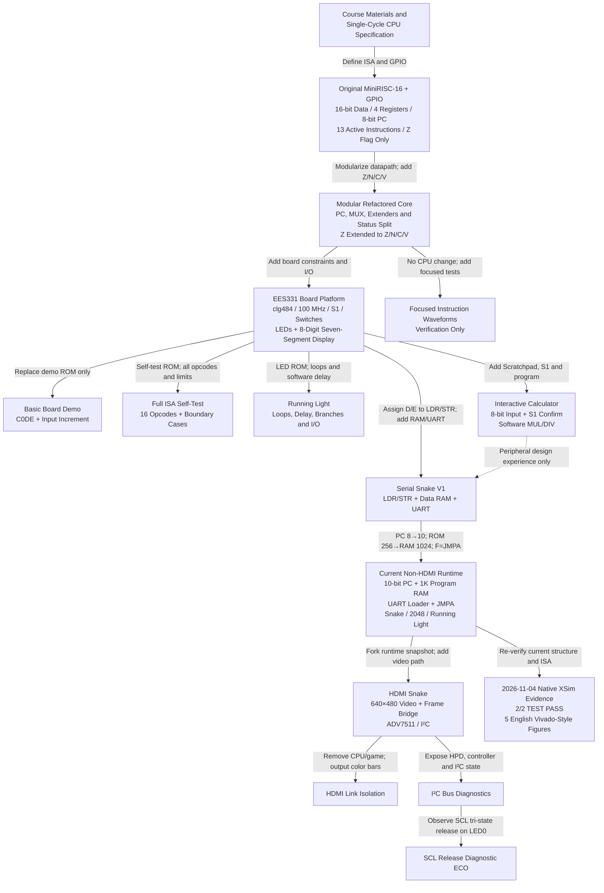
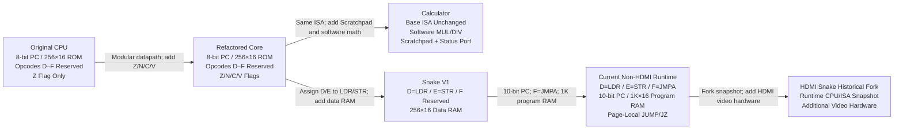
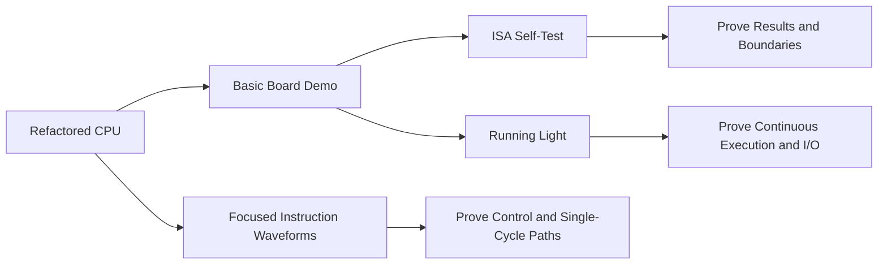
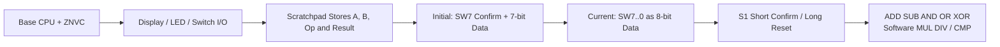
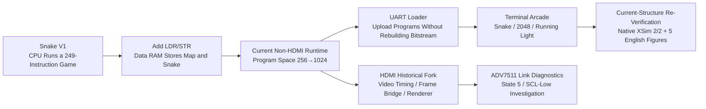

# MiniRISC-16 项目分支与演进图

整理日期：2026-11-05。当前展示基准为 `refactored_design/runtime_system/` 中最新的非 HDMI 终端版。

这里的“分支”指从同一 CPU 基线发展出的不同工程方向，不等同于 Git branch。现有实现通过独立文件夹、独立 RTL 副本、独立 Vivado 工程/脚本和独立 bitstream 隔离，因此一个方向的修改不会自动同步到另一个方向。

## 1. 整体分支图

图中节点表示工程版本或方向；连线文字表示它相对来源版本新增、替换或保持不变的部分。



主干关系可以概括为：

```text
原始单周期 CPU
  → 模块化 + ZNVC
  → EES331 板级资源
     ├─ 验证方向：基础演示 / ISA 自检 / 流水灯 / 指令波形
     ├─ 运算应用方向：交互式计算器
     └─ 游戏与运行时方向：Snake V1 → 当前非 HDMI Runtime（主展示版）
                                      ├─ 当前结构/ISA 的 XSim 波形验证
                                      └─ HDMI 历史扩展 → HDMI 诊断
```

## 2. CPU 与 ISA 的演进



需要特别注意：

- 计算器和 Snake 是两个应用方向。计算器没有加入乘法、除法指令，而是让 CPU 执行循环程序，证明基础 ISA 能完成复杂运算。
- Snake 为保存地图和蛇身首次加入数据存储器，并占用原保留 opcode `D/E` 作为 `LDR/STR`。
- Runtime 为扩大程序容量，把 PC 从 8 位扩到 10 位，并把最后一个保留 opcode `F` 用作跨页绝对跳转 `JMPA`。当前非 HDMI 终端版以该结构为最新展示基准。
- HDMI 版从当时的 Runtime 快照分出，主要变化发生在视频输出和板级顶层；当前答辩与波形不能用 HDMI 分支替代最新非 HDMI Runtime。

## 3. 各分支具体调整

| 分支 | 从哪里发展 | CPU/ISA 调整 | 存储器调整 | 新增输入输出或硬件 | 主要目的 |
|---|---|---|---|---|---|
| 原始基线 | 设计 md | 13 条有效指令；CMP 更新 Z | 256×16 组合读指令 ROM | 8 位双向 GPIO | 建立单周期 CPU 与基础系统仿真 |
| 模块化重构 | 原始基线 | datapath 拆成可见模块；ADD/SUB/CMP 等维护 ZNVC | 容量不变 | GPIO 三态收进外设模块 | 让层级、验证和上板接口更清楚 |
| 基础板级演示 | 重构核心 | 不改 ISA | 换用 `board_demo.mem` | EES331 LED、拨码、S1、8 位数码管 | 验证下载、时钟、复位、INP/OUP 和显示 |
| ISA 自检 | 基础板级 | 不改 RTL；程序覆盖 D/E/F 保留行为和边界运算 | 独立 ROM 程序 | 用 LED/数码管输出 PASS 或错误码 | 在实板自动检查全部 16 个 opcode |
| 流水灯 | 基础板级 | 不改 RTL | 独立流水灯 ROM | LED 单灯循环 | 展示持续执行、软件延时、CMP/JZ/JUMP 与 I/O |
| 指令聚焦波形 | 重构核心 | 不改 RTL | testbench 内短程序 | 五组独立 WDB/WCFG/VCD/PNG | 展示“译码→控制→数据通路→时钟沿提交” |
| 交互式计算器 | 重构/板级经验 | ISA 保持基础版本；增加 Flags 对外观察 | 256×16 程序 ROM；16×16 Scratchpad | S1 短按确认/长按复位、8 位拨码、LED、数码管 | 完成 8 种运算和完整交互状态机 |
| Snake V1 | 重构核心 + 外设经验 | `D=LDR`、`E=STR` | 256×16 程序 ROM + 256×16 数据 RAM | UART、tick、LFSR、拨码、显示、LED | 让 CPU 执行完整游戏逻辑 |
| 当前非 HDMI Runtime | Snake V1 | PC 10 位；`F=JMPA`；JUMP/JZ 改为页内；保留 `D=LDR`、`E=STR` | 1K×16 可写程序 RAM + 256×16 数据 RAM | UART Loader、统一 Arcade Launcher、Snake/2048/Running Light 终端 | bitstream 固定后可换程序；作为当前结构、ISA 与波形展示基准 |
| 当前 Runtime 波形验证 | 当前非 HDMI Runtime | 不改 RTL；针对当前 10 位 PC 与扩展 ISA 建立聚焦 testbench | 直接观察 1K 程序空间和数据 RAM 接口 | 原生 XSim WDB/VCD/WCFG、5 张英文 Vivado 风格分图 | 证明单周期提交、分支跳转、寄存器回写、LED I/O 和 LDR/STR |
| HDMI Snake | Runtime 历史快照 | 建立分支时 CPU 核保持不变 | 程序/数据存储结构保持 | 25.175 MHz 像素时钟、640×480、帧 CDC、渲染器、ADV7511/I²C | 将 UART 字符棋盘扩展为板载 HDMI 图形输出 |
| HDMI 诊断 | HDMI Snake | 不改 CPU 游戏逻辑；部分诊断顶层不运行 CPU | 使用已有实现或诊断设计 | LED 映射 HPD、I²C 状态、SCL/SDA 和三态控制 | 定位“无画面、I²C 等待 SCL 升高” |

## 4. 三条主要方向分别解决了什么

### 4.1 验证与展示方向



这一方向没有继续扩大 CPU 的能力，而是针对不同问题提供证据：基础演示验证板级闭环，ISA 自检验证指令，流水灯验证持续程序，聚焦波形解释内部工作方式。

### 4.2 运算应用方向



计算器目录完整保存在 `refactored_design/calculator_system/`，包含 RTL、程序、testbench、约束、脚本、报告、bitstream、Vivado 生成目录和说明。当前检查没有在 `vivado_project/` 根部找到 `MiniRISC16_Calculator.xpr`，但这只是 GUI 工程入口文件的状态，不能表述成“计算器项目不在”或“计算器文件缺失”。源码和可重建工程所需内容都仍在。

### 4.3 游戏与运行时方向



该方向的核心演进不是单纯增加游戏画面，而是逐步把 CPU 系统变成可编程的小型计算机：先有数据 RAM，再有更大的可写程序存储器和 Loader，随后形成可切换 Snake、2048 和 Running Light 的非 HDMI 终端 Arcade。HDMI 是从该路线较早阶段分出的独立显示扩展，不是当前终端版的后继验证结果。

## 5. 文件与分支对应关系

| 路径（位于 `MiniRISC-16-CPU/refactored_design/`） | 所属方向 |
|---|---|
| `rtl/`、`vivado_project/`、`sim/` | 重构 CPU 公共基线与 CPU 级验证 |
| `board_vivado_project/`、`reports/board/` | 基础板级演示 |
| `board_isa_vivado_project/`、`reports/board_isa/` | ISA 全指令自检 |
| `board_led_vivado_project/`、`reports/board_led/` | 流水灯 |
| `instruction_waveforms/` | 五类指令聚焦波形 |
| `calculator_system/` | 交互式计算器独立工程 |
| `snake_system/` | 串口贪吃蛇 V1 独立工程 |
| `runtime_system/` | 当前非 HDMI Runtime、终端 Arcade 与当前 XSim 波形验证 |
| `hdmi_snake_system/` | HDMI Snake 与诊断独立工程 |

`MiniRISC-16-CPU-main/` 是较早的基础工作副本；它不是上述应用树的共同运行目录。两个 ZIP 是保存副本，未参与当前各分支构建。

## 6. 目前各方向的状态

| 分支 | 文件/自动验证 | 用户实板反馈或当前限制 |
|---|---|---|
| 基础板级演示 | bitstream、实现和时序报告存在 | 用户反馈测试通过 |
| ISA 自检 | 模型、bitstream、时序报告存在 | 指南和预期 PASS/错误码完整；不能由基础演示反馈替代每项实拍 |
| 流水灯 | 模型、bitstream、时序报告存在 | 回卷 Bug 已修复；适合作为演示分支 |
| 计算器 | 参考模型 15/15、XSim 9/9、bitstream 存在 | 独立项目目录完整；README 仍要求最终人工验收 |
| Snake V1 | 汇编/模型/XSim/bitstream 存在 | 后续聊天反馈已能运行，并由此继续开发 Runtime |
| 当前非 HDMI Runtime | 历史基础回归 XSim 6/6；2026-11-04 当前结构波形测试原生 XSim 2/2 PASS；WDB/VCD/WCFG 与 5 张英文分图存在 | Snake/2048/Running Light 参考模型均通过；当前波形与讲解以此分支为准 |
| HDMI Snake | 历史 XSim 10/10、bitstream 存在 | 实板无正常画面；问题集中到 ADV7511/I²C 链路 |
| HDMI 诊断 | 三个诊断 bit 均存在 | 最新 SCL 释放诊断尚待板上结果 |

## 7. 阅读和修改时的规则

1. 先确认目标分支，再修改该分支自己的 RTL。修改 `refactored_design/rtl/` 不会自动更新 `calculator_system/rtl/`、`snake_system/rtl/` 或 `runtime_system/rtl/`。
2. 不同分支对 opcode `D/E/F` 的定义不同，不能随意交换 ROM、汇编器或 controller。
3. 当前 Runtime 和 HDMI 历史分支的 PC 是 10 位；原版、计算器和 Snake V1 是 8 位。
4. HDMI 从 Runtime 快照建立，但两个目录之后独立维护。需要修 CPU/Loader 时应评估是否同步，不能假定当前文件仍完全相同；视频/I²C 修改通常只属于 HDMI 分支。
5. 板级演示、ISA 自检和流水灯主要共享重构 RTL，差别集中在 ROM 程序、testbench、工程和 bitstream。
6. 计算器经历过 7 位输入方案到完整 8 位方案的改版；讨论旧方案时要注明版本，当前源文件以 8 位 + S1 确认为准。

## 8. 主要依据

- 各分支 README、BOARD_TEST_GUIDE、BUG_FIX_LOG 和 verification-summary。
- 当前 RTL 模块清单及同名核心文件的逐文件哈希比较。
- CPU 相关聊天中关于重构、上板、计算器、Snake、Runtime、HDMI 和答辩波形的记录。
- 当前实际存在的 XPR、bitstream、程序、脚本、报告和诊断状态文件。
- `runtime_system/reports/waveforms/current_terminal/` 中 2026-11-04 的原生 Vivado/XSim 日志、WDB/VCD/WCFG 与英文波形图。

本图表达的是工程血缘和功能演进，不表示所有分支都已合并，也不表示每个文件夹都是一个 Git branch。
